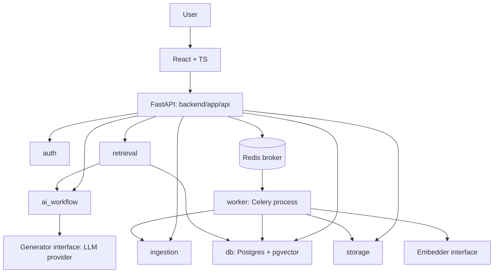

# Axiom — Architecture (Phase 1, Step 2)

Modular monolith. One codebase (`backend/app/`), two runtimes: API process + Celery worker process. PostgreSQL (+pgvector) is the source of truth. Redis is transport only.

## Diagram

Same `backend/app` import path in both processes. Worker imports `ingestion` + `storage` + `db`, never HTTP handlers.

## Modules and ownership

| Module | Owns | Must not own |
|---|---|---|
| `api/` | routes, Pydantic I/O, authZ checks, enqueue | parsing, embeddings, LLM prompts |
| `auth/` | users, workspaces, memberships, JWT, scope resolution | document parsing |
| `ingestion/` | validation, parser selection, chunking, embed-request, index write | HTTP, LLM generation |
| `worker/` | task defs, claim, retries, sweeper, state transitions | response shaping |
| `retrieval/` | query embed, pgvector + FTS query, authZ filter, rank, evidenceDTO | answer wording |
| `ai_workflow/` | grounded generation, citation validation, abstention | cost math, approval transitions |
| `storage/` | `FileStorage` interface, local impl, internal names | DB schema |
| `db/` | engine, session, Alembic migrations, models | file bytes, LLM calls |

`solutions/` + `proposals/` arrive in Phase 8. No imports to them before then.

## Dependency rules

1. `api` → `auth, ingestion, retrieval, ai_workflow, storage, db`. Never the reverse.
2. `worker` → `ingestion, storage, db`. Never → `api`.
3. `retrieval, ai_workflow` → `db`. Never → `worker`, never → `storage` bytes.
4. `ingestion` → `storage, db`. Parser/OCR/Whisper adapters live behind interfaces inside `ingestion/`.
5. Cross-workspace filtering happens in `db` queries + `retrieval`, never in UI.
6. Money math lives in Phase 8 `solutions/` with `Decimal`. LLM never computes totals.

Violations fail review; enforced by import lints from Phase 2.

## Runtimes

- API: `uvicorn backend.app.main:app`. Stateless, no in-memory jobs.
- Worker: `celery -A backend.app.worker.celery_app worker`. Receives `document_id` only.
- Infra (Compose): `postgres:pgvector`, `redis` (persisted, no eviction), `api`, `worker`.

## Request flows

Upload: `UI → POST /documents → api validates → storage.save → db(doc=uploaded) → db(doc=queued)+enqueue → 202 {document_id}`.
Worker: `claim (UPDATE...WHERE RETURNING) → storage.open → ingest → embed → db chunks+indexed in one txn`.
Chat: `POST /chat → auth scope → retrieval (workspace_id filter) → ai_workflow generate+validate citations → trace row → answer`.

## Failure pointers

File/model/DB/queue/auth failure taxonomy, retry bounds, and sweeper thresholds live in `04-job-reliability-contract.md` (Phase 1, Step 5). This diagram adds no new behavior.
