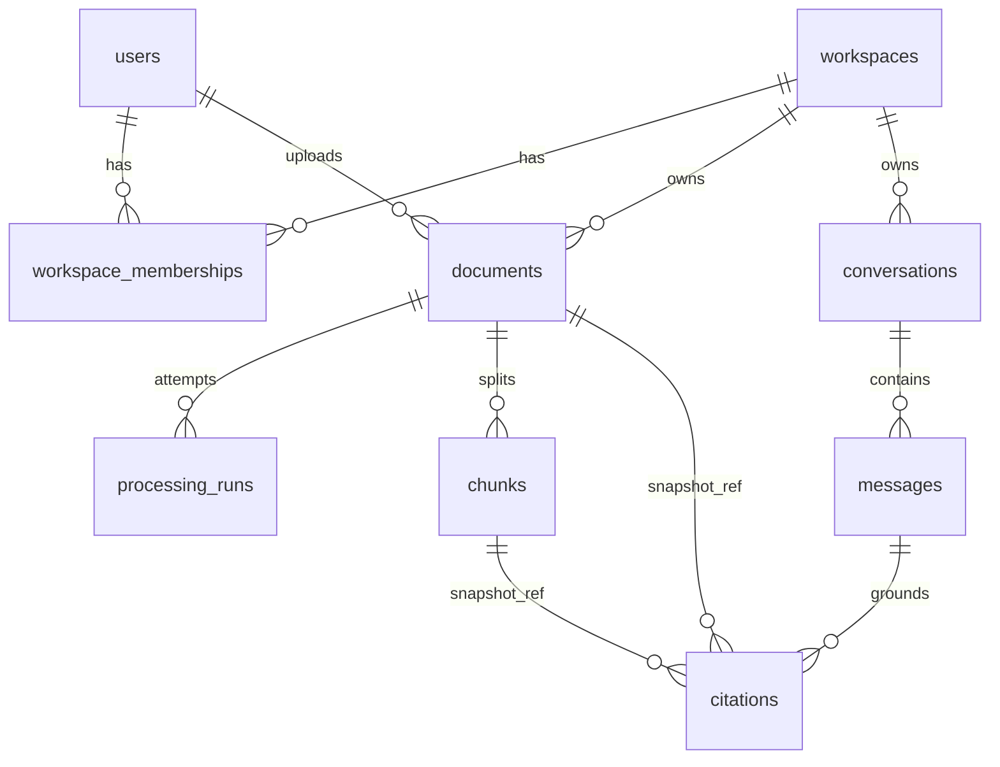

# Axiom — ERD + /api/v1 Draft (Phase 1, Step 3)

Scope: Phases 2–5 only (PDF text RAG v0.1). Later tables sketched in §10, not designed.

Legend: `[v0.1]` = mandatory for v0.1. `[later]` = explicitly deferred.

## 1. ERD



`snapshot_ref` is a non-enforced reference (no FK): the citation keeps working after the source row is gone.

## 2. Tables (v0.1)

All user-data tables carry `workspace_id` from creation. Server resolves it from membership, never from client input. UUID PKs everywhere.

**users** — `id, email UNIQUE NOT NULL, password_hash NOT NULL, created_at`. No FK to anything `[v0.1]`.

**workspaces** — `id, name NOT NULL, created_at`.

**workspace_memberships** — `user_id FK→users ON DELETE CASCADE, workspace_id FK→workspaces ON DELETE CASCADE, role ENUM(owner,admin,member,viewer), created_at`; PK `(user_id, workspace_id)` `[v0.1]`.

**documents** — `id, workspace_id FK→workspaces ON DELETE RESTRICT, uploaded_by (snapshot UUID, NO FK — see §4), original_filename, storage_key UNIQUE, mime_type, size_bytes, checksum, status ENUM(uploaded,queued,processing,retrying,indexed,failed), processing_attempts INT DEFAULT 0, error_code NULL, error_message NULL, retryable BOOLEAN NOT NULL DEFAULT false, created_at, updated_at, indexed_at NULL`; `UNIQUE(id, workspace_id)` (composite-FK target); `INDEX(workspace_id, status, created_at)`; `INDEX(workspace_id, checksum)` (dup warn, not unique — see §7); `INDEX(status, updated_at)` (sweeper scan — revision `0002`) `[v0.1]`.

**processing_runs** — `id, document_id NOT NULL, workspace_id NOT NULL, attempt_no INT NOT NULL, stage TEXT NOT NULL, started_at, finished_at NULL, error_code/message NULL`; FK `(document_id, workspace_id) → documents(id, workspace_id) ON DELETE CASCADE` `[v0.1]`; `UNIQUE(document_id, attempt_no)` `[v0.1]`.

**chunks** — `id, document_id NOT NULL, workspace_id NOT NULL, chunk_index INT NOT NULL, content TEXT NOT NULL, page_number INT NULL, source_type TEXT DEFAULT 'text', chunk_version TEXT NOT NULL, embedding_model TEXT NOT NULL, embedding_dim INT NOT NULL, embedding VECTOR NOT NULL, created_at`; FK `(document_id, workspace_id) → documents(id, workspace_id) ON DELETE CASCADE` `[v0.1]`; `UNIQUE(document_id, chunk_index)` `[v0.1]`; `CHECK(chunk_index >= 0)` `[v0.1]`; `CHECK(embedding_dim > 0)` `[v0.1]`; `INDEX(workspace_id)` (exact filtered scan; no ANN in v0.1). `start_ts/end_ts` are `[later]` (audio/video, Phase 7).

**conversations** — `id, workspace_id FK→workspaces ON DELETE RESTRICT, created_by (snapshot UUID, NO FK — same rule as uploaded_by), title NULL, created_at`; `UNIQUE(id, workspace_id)`; `INDEX(workspace_id, created_at)` `[v0.1]`.

**messages** — `id, conversation_id NOT NULL, workspace_id NOT NULL, role ENUM(user,assistant), content TEXT NOT NULL, prompt_version NULL, model NULL, latency_ms NULL, tokens NULL, created_at`; FK `(conversation_id, workspace_id) → conversations(id, workspace_id) ON DELETE CASCADE` `[v0.1]`; `UNIQUE(id, workspace_id)`; `INDEX(conversation_id, created_at)` `[v0.1]`.

**citations** — `id, message_id NOT NULL, workspace_id NOT NULL, document_id NOT NULL (snapshot, NO FK — see §3), chunk_id NULL FK→chunks(id) ON DELETE SET NULL, original_filename TEXT NOT NULL (snapshot), page_number NULL, passage_text TEXT NOT NULL (snapshot), score NULL, created_at`; FK `(message_id, workspace_id) → messages(id, workspace_id) ON DELETE CASCADE` `[v0.1]`; `INDEX(message_id)` `[v0.1]`.

Reference implementation: `backend/app/db/models.py:1` — **aligned with this section** (Step 9.4): it contains `original_filename` on citations, the `processing_runs` unique constraint, the chunk CHECKs/indexes, and the `ON DELETE` actions above. Migration `backend/alembic/versions/0001_v01_init.py` matches the original schema and has been executed against a real PostgreSQL 18.6 + pgvector 0.8.1 instance. Revision `0002_phase4_background_processing.py` adds `documents.retryable` and the `(status, updated_at)` sweeper index.

ENUM note: `document_status`, `membership_role` and `message_role` are native PostgreSQL ENUM types. Revision 0001 creates each one **exactly once** (see `create_type=False` in the migration) — SQLAlchemy's default automatic `CREATE TYPE` emission would otherwise produce a duplicate that PostgreSQL rejects. `backend/tests/test_migration_sql.py` guards this.

## 3. Deletion policy [v0.1]

Goal: deleting a document removes the file and index but never deletes conversation history (US-07 + audit).

- `DELETE /documents/{id}` (admin+, terminal/cancellable states only — see §6) flushes the scoped `DELETE FROM documents WHERE id AND workspace_id`, removes the storage object, then commits. Cascades remove `chunks` and `processing_runs` automatically. A storage outage rolls the row deletion back and returns `503`; a missing object is idempotent. No worker may re-insert after this (guarded commit, §6).
- `citations.document_id` has NO foreign key, so deletion is never blocked and history is never cascade-deleted. Each citation already stores `document_id` (value), `original_filename`, `page_number`, and `passage_text`; all remain readable after deletion.
- `citations.chunk_id → chunks(id) ON DELETE SET NULL`: live citations can join the chunk; after deletion or re-index the id NULLs out but the snapshot (`passage_text`, page, filename) stays valid.
- `citations → messages ON DELETE CASCADE`: citations die only with their own conversation (message/conversation delete), never with the source document.
- `processing_runs` CASCADE with the document (operational history, not the audit trail). Permanent audit of who-deleted-what is `[later]` (`audit_logs`, Phase 10); v0.1 minimum is `updated_at` + error/status columns plus a server log line. Extension point: add `audit_logs` insert in the same delete transaction without changing FKs.

What is removed vs kept on document delete:

| Data | On document delete |
|---|---|
| Original file (storage object) | removed `[v0.1]` |
| `chunks` + vectors | removed via CASCADE `[v0.1]` |
| `processing_runs` | removed via CASCADE `[v0.1]` |
| `citations` (+ parent messages/conversations) | kept; `chunk_id` → NULL `[v0.1]` |

## 4. Workspace isolation and referential integrity [v0.1]

- `chunks(document_id, workspace_id) → documents(id, workspace_id)`: cross-workspace chunk attach is impossible at the DB level. Backed by `UNIQUE(documents.id, workspace_id)`.
- `messages(conversation_id, workspace_id) → conversations(id, workspace_id)` and `citations(message_id, workspace_id) → messages(id, workspace_id)`: same guarantee for chat history. Backed by the corresponding `UNIQUE(id, workspace_id)` constraints.
- `citations → documents` is intentionally NOT a foreign key (see §3). Trade-off: the DB cannot prove a citation's `document_id` belongs to the citation's workspace. Recommendation: enforce at write time — citations are created server-side in the same request/transaction that runs workspace-filtered retrieval, asserting `chunk.workspace_id == citation.workspace_id AND chunk.document_id == citation.document_id` before insert, plus a regression test. A trigger or composite-FK redesign was rejected for v0.1 as unnecessary machinery for a server-written table.
- `citations.chunk_id → chunks(id)` is single-column with `SET NULL` (not composite) for the same reason: a composite `(chunk_id, workspace_id, document_id)` FK would require NULLing all three on re-index, colliding with the `messages` FK on `workspace_id`. Existence is DB-enforced; workspace/document match is server-validated at write time.
- `documents.uploaded_by`, `conversations.created_by`: plain UUIDs, NO FK to `users` `[v0.1]`. Rationale: user lifecycle (delete/deactivate) is `[later]`; an FK would couple document survival to account management. Authorship is checked against live membership at request time, not via the FK.
- `documents.workspace_id`, `conversations.workspace_id → workspaces(id) ON DELETE RESTRICT`: workspace deletion is `[later]`; RESTRICT prevents accidental orphaning. Membership rows CASCADE with either parent.
- No redundant FKs: exactly one enforced path per parent-child pair listed in §2. Every `workspace_id` filter is additionally applied in application queries, including vector search (`WHERE workspace_id = :ws` before similarity ordering).

## 5. Permissions matrix [v0.1]

Least privilege. `owner` = `admin` for all v0.1 document/chat operations; the only owner/admin difference is workspace management `[later]` (members, billing, workspace delete). Membership and role checks are server-side per request; UI hiding is not enforcement.

| Action | viewer | member | admin | owner |
|---|---|---|---|---|
| List/read documents (`GET /documents`, `GET /documents/{id}`, `GET /documents/{id}/file`) | ✅ own workspace | ✅ | ✅ | ✅ (= admin) |
| Upload (`POST /documents`) | ❌ | ✅ | ✅ | ✅ |
| Chat + read own conversations (`POST /chat`, `GET /conversations/{id}`, `.../messages`) | ✅ own only | ✅ own only | ✅ any in workspace | ✅ any in workspace |
| Retry failed job (`POST /documents/{id}/retry`) | ❌ | ✅ | ✅ | ✅ |
| Delete document (`DELETE /documents/{id}`) | ❌ | ❌ | ✅ | ✅ |

Notes: conversations are private to their creator except admin/owner reads `[v0.1]`; shared workspace conversations are `[later]`. Cross-workspace IDs → `403/404` without leaking existence (use `404` for reads, `403` for writes the membership forbids — fixed per endpoint in §8, applied consistently).

## 6. Worker reliability and state transitions [v0.1, implemented in Phase 4]

Allowed transitions (actor in brackets). `processing_attempts` increments **only** on a worker claim:

```text
POST /documents commits queued (processing_attempts=0), then publishes best effort
queued --[worker claim]--> processing
processing --[worker: transient fail, claims remain]--> retrying
retrying --[fresh task then worker claim]--> processing
processing / retrying --[worker guarded commit]--> indexed
processing / retrying --[worker: permanent or attempts exhausted]--> failed
queued / retrying --[sweeper: attempts at cap]--> failed
processing --[sweeper: stale, claims remain]--> retrying
processing --[sweeper: stale, attempts at cap]--> failed
uploaded --[sweeper]--> queued
failed --[member+ POST retry, retryable only]--> queued (no attempt increment)
uploaded / queued / indexed / failed --[admin+ DELETE]--> (row removed)
processing / retrying --[DELETE]--> 409 CONFLICT (delete blocked while worker owns the doc)
```

Rules:

1. Claim: the task payload carries only `document_id` (D-017). The worker reads the row's `workspace_id`, then performs one conditional `UPDATE documents SET status='processing', processing_attempts=processing_attempts+1, updated_at=now(), error_code=NULL, error_message=NULL, retryable=false WHERE id=:id AND workspace_id=:ws AND status IN ('queued','retrying') AND processing_attempts < :max_attempts RETURNING ...`, and inserts a `processing_runs` row with `stage='claimed'` and the returned attempt number in the same transaction. Zero rows → rollback and exit quietly (another worker/sweeper won, or the cap is exhausted) `[v0.1]`.
2. Guarded commit: chunks + status change in ONE transaction: `DELETE chunks WHERE document_id AND workspace_id` → flush the `INSERT` of the new set (a duplicate `(document_id, chunk_index)` raises `CHUNK_CONFLICT` and rolls everything back) → `UPDATE documents SET status='indexed', indexed_at=now(), error_code=NULL, retryable=false WHERE id AND workspace_id AND status IN ('processing','retrying') AND processing_attempts=:claimed RETURNING id` → close the run row (`stage='indexed'`, `finished_at=now()`). A zero-row document update → ROLLBACK (stale worker or concurrent delete wins; the previous chunk set remains visible and nothing is re-inserted) `[v0.1]`.
3. Delete vs worker race: delete is `409` during `processing/retrying`, so the race window is claim-commit. If the row is gone at commit time, the FK + zero-row guard abort the transaction; the worker must not recreate the parent row `[v0.1]`.
4. Re-index/duplicate delivery: same task twice → one claim wins (§6.1); the loser exits with `noop`. A retry re-runs the full transaction in rule 2 (delete-then-insert), so no duplicate or mixed-version chunks. The processor is responsible for embedding/model/dimension consistency; a conflict aborts the commit and leaves the previous set intact `[v0.1]`.
5. Save-succeeded/enqueue-failed: the implemented upload path keeps Phase 3's single-commit handoff: bytes are durable, the row is committed directly as `queued`, and the broker publish happens after the commit as a best effort. A failed publish leaves a `queued` row that the sweeper republishes after `SWEEPER_QUEUED_STALE_SECONDS`; the API still returns `202`. The `uploaded` state and its sweeper rule remain supported for a split writer, but no current code path creates `uploaded` (D-016). A transactional outbox is `[later]`; extension point: add an `outbox_events` insert to the upload transaction and a dispatcher, with no FK changes required.
6. Crash mid-task: no in-memory state is authoritative; the sweeper + attempt cap is the only recovery path. A `processing` row older than `SWEEPER_PROCESSING_STALE_SECONDS` (900 s by default, greater than the 600 s hard task limit) moves to `retrying` with `PROCESSING_TIMEOUT` and `retryable=true`, or to `failed` with `ATTEMPTS_EXHAUSTED` at the cap. The open run row is closed with `stage='timeout'`. Broker visibility timeout (1800 s) must exceed max task runtime `[v0.1]`.
7. Retry endpoint: only from `failed` with `retryable=true`. One conditional `UPDATE ... SET status='queued', error_code=NULL, error_message=NULL, retryable=false` clears the error and returns the row. It does **not** increment `processing_attempts` and does **not** insert a run row; the next worker claim does both. Double-clicking retry is idempotent (the second call sees `queued`, matches zero rows, returns `409`, and starts no new attempt). A manual retry at the cap is accepted into `queued` but cannot be claimed; the sweeper fails it as `ATTEMPTS_EXHAUSTED` `[v0.1]`.
8. Failure classification: transient (`STORAGE_UNAVAILABLE`, `STORAGE_IO_ERROR`, `PROCESSING_TIMEOUT`) retries automatically while claims remain. Permanent-fixable (`FILE_MISSING`, `STORAGE_PERMISSION_DENIED`) sets `failed` with `retryable=true`. Permanent-final (`CHUNK_CONFLICT`, `STORAGE_PATH_INVALID`, `CHECKSUM_MISMATCH`, `INVALID_PDF`, `EMPTY_FILE`, `INTERNAL_ERROR`) sets `failed` with `retryable=false`. Automatic retries use `min(base * 2^(attempt-1) + jitter, maximum)` and publish a fresh task after the `retrying` transition commits; `self.retry()` is not used (D-020) `[v0.1]`.
9. Run-row lifecycle: one row per claim, unique `(document_id, attempt_no)`. Claim opens it as `claimed`; commit/failure closes it as `indexed`/`retrying`/`failed`; the sweeper closes a timed-out run as `timeout`. A retrying run row is closed, and the next attempt gets a new row. A manual retry creates no row until a claim starts `[v0.1]`.

## 7. Constraints, indexes, and pagination [v0.1]

Add only what v0.1 access patterns justify (no ANN index):

- `UNIQUE(processing_runs.document_id, attempt_no)` — one row per attempt (DB) `[v0.1]`.
- `UNIQUE(chunks.document_id, chunk_index)` + `CHECK(chunk_index >= 0)` — idempotent chunk sets (DB) `[v0.1]`.
- `CHECK(chunks.embedding_dim > 0)` (DB); exact model↔dim match validated app-side at index and query time, with a Phase 5 consistency test (no silent model mix) `[v0.1]`.
- `INDEX(documents.workspace_id, status, created_at)` — status-filtered lists; `ORDER BY created_at, id` with `limit default 20 max 100` for stable pagination `[v0.1]`.
- `INDEX(documents.status, updated_at)` — global stale-document scan for the sweeper; the workspace-scoped index cannot serve a query that intentionally spans workspaces `[v0.1]`.
- `INDEX(documents.workspace_id, checksum)` — duplicate-upload warning lookup (non-unique: warn and return existing, but allow intentional re-upload) `[v0.1]`. Trade-off: a UNIQUE constraint would enforce dedup strictly but block legitimate re-uploads of identical content under a new name; warning was chosen.
- `INDEX(chunks.workspace_id)` — workspace-filtered exact vector scan `[v0.1]`.
- `INDEX(conversations.workspace_id, created_at)`, `INDEX(messages.conversation_id, created_at)`, `INDEX(citations.message_id)` — history reads `[v0.1]`.
- Emails: app-lowercased + `UNIQUE`; `citext` is `[later]`.

## 8. /api/v1 contract [v0.1]

Base `/api/v1`, Bearer JWT, envelope `{error:{code,message,retryable,request_id}}`. `workspace_id` always from membership. New endpoint `GET /documents/{id}/file` is added because without it there is no authorized file-access path (frontend must never touch storage directly).

### 8.1 Authentication and workspaces (Phase 2, implemented)

The access token carries **only** the user id (`sub`), an issued-at and an expiry. Workspace and role are **never** read from the token: they are resolved from `workspace_memberships` on every request, so a revoked membership or a demotion takes effect on the next request instead of at token expiry. A client may send `X-Workspace-ID` to *select* one of several workspaces it belongs to; the value is verified against the database and grants nothing on its own.

| Method | Endpoint | Role | Success | Errors | Scoping / state |
|---|---|---|---|---|---|
| `POST` | `/auth/login` `{email, password}` | none | `200 {access_token, token_type, workspaces[{workspace_id, role}]}` | `401 UNAUTHENTICATED` (generic: unknown email and wrong password are indistinguishable), `429 RATE_LIMITED` (too many failures), `422` | failures are counted per account **and** per source IP; a successful login clears both counters |
| `GET` | `/auth/me` | any member | `200 {id, email, workspace_id, role}` | `401`, `403` (no membership / several workspaces without `X-Workspace-ID`) | identity from token, workspace+role from DB |
| `POST` | `/auth/logout` | none | `204` | — | stateless JWT: the client discards the token; server-side revocation is `[later]` |
| `POST` | `/workspaces` `{name}` | authenticated | `201 {id, name, created_at}` | `401`, `422` | creator becomes `owner`; workspace + membership written in one transaction |
| `GET` | `/workspaces` | authenticated | `200 [WorkspaceRead]` | `401` | only workspaces the caller belongs to |
| `GET` | `/workspaces/{id}` | viewer+ in that workspace | `200 {…, members[]}` | `401`, `403` | membership checked against the path's workspace |
| `POST` | `/workspaces/{id}/members` `{email, role, password?}` | admin+ in that workspace | `201 WorkspaceMemberRead` | `401`, `403`, `409 INVALID_STATE` (already a member), `422` | creates the account if the email is unknown; `password` is ignored for an existing account; `owner` is not grantable |

Provisioning: Axiom has **no public registration**. The only path that creates a user is an admin adding them to a workspace. The first administrator is created once, by hand, with `python -m app.auth.bootstrap --email <email> --workspace <name>`; the command refuses to run when the database already has users.

**Login rate limiting (step 2.7).** Redis counts *failures*, not attempts, so a user who mistypes once is not punished; a successful login clears the counter. Two limits apply: per account (5 failures / 60 s) and per source IP (30 failures / 60 s, higher because many users share one address). The window is fixed — the TTL starts at the first failure. If Redis is unreachable the limiter **fails open** and logs a warning: failing closed would turn a Redis outage into a total login outage, and the credential check still applies either way. `X-Forwarded-For` is deliberately not trusted, because a client could otherwise spoof it to escape the per-IP limit.

### 8.2 Documents (Phase 2 API + Phase 3 ingestion + Phase 4 processing, implemented)

Uploads are accepted as PDF only. The file is written through the `FileStorage` port to `<storage_root>/uploads/{document_id}/original.pdf`; the row is committed as `queued` in the same request; the `202` is returned only after **both** the bytes and the row are durable. The path is built from the server-generated document id, never from the user's filename. Phase 3 implements the upload contract below; Phase 4 adds the post-commit broker publish and the worker lifecycle. No Phase 3 migration was required: the existing `documents.checksum` column and non-unique `(workspace_id, checksum)` index carry deduplication. Phase 4 adds `documents.retryable` and the `(status, updated_at)` sweeper index in revision `0002`.

| Method | Endpoint | Role | Success | Errors | Scoping / state |
|---|---|---|---|---|---|
| `POST` | `/documents` (multipart PDF, optional `?allow_duplicate=true`) | member+ | `202 {document_id, status:'queued', duplicate:false}`; `200 {document_id, status, duplicate:true}` on a duplicate | `400 VALIDATION_ERROR` (not a PDF, empty, too large), `401`, `403`, `503 DEPENDENCY_UNAVAILABLE` (storage write failed) | `workspace_id` from membership; file written before the row is committed; dedup is workspace-scoped (see below) |
| `GET` | `/documents?status_filter=&q=&limit=&offset=` | viewer+ | `200 {items, total}` ordered `(created_at,id)` | `401`, `403` | workspace-filtered in SQL; `q` matches filename only; limit 20 default / 100 max |
| `GET` | `/documents/{id}` | viewer+ | `200` metadata+status+error | `401`, `404` (incl. other-workspace ids) | membership-checked |
| `GET` | `/documents/{id}/file` | viewer+ | `200` file stream | `401`, `404`, `409 INVALID_STATE` (status `uploaded` or stored object missing), `503 DEPENDENCY_UNAVAILABLE` | the only authorized path to the bytes; no local path is exposed |
| `POST` | `/documents/{id}/retry` | member+ | `200 {document_id, status:'queued'}` | `401`, `404`, `409 INVALID_STATE` (not `failed`, or `retryable=false`), `403` | conditional `failed + retryable → queued`; clears the error and `retryable`; does **not** increment `processing_attempts`; the next claim consumes the attempt |
| `DELETE` | `/documents/{id}` | admin+ | `204` | `401`, `404`, `409 INVALID_STATE` (in `processing/retrying`), `403`, `503 DEPENDENCY_UNAVAILABLE` (storage delete failed; the row deletion rolls back) | file + row removed; chunks/runs cascade; citations keep their snapshots |

Ordering rule for single-document routes: the **resource is resolved before the role is checked**, so a document in another workspace always answers `404` no matter which role the caller holds. A `403` would confirm that the id exists.

Storage access goes through `app/storage/base.py`; the API routes and the worker never import `pathlib`, `open`, or `shutil`. Keys are server-generated POSIX paths (`uploads/{document_id}/original.pdf`), and `LocalFileStorage` writes atomically with a temporary file, `fsync`, and `os.replace`. Compose gives both the API and worker the same bind-mounted `STORAGE_ROOT` (`/srv/backend/storage`), which is what makes the Phase 4 read path possible.

#### Phase 3 upload contract (implemented)

Phase 3 keeps the existing `POST /documents` shape and adds workspace-scoped checksum deduplication:

| Case | Success | Behaviour |
|---|---|---|
| New content | `202 {document_id, status:'queued', duplicate:false}` | The file is stored first, then the row is committed as `queued` |
| Same checksum in the caller's workspace | `200 {document_id: existing_id, status: existing_status, duplicate:true}` | No new row and no new file; the existing document's metadata (filename, uploader, timestamps) is unchanged |
| Same checksum, `?allow_duplicate=true` | `202 {document_id: new_id, status:'queued', duplicate:false}` | Intentional re-upload; a second document and file are created |
| Same checksum in another workspace | `202` with a new document | Dedup is workspace-scoped; another workspace's id is never returned |
| Existing match is `failed` | `200` with `status:'failed', duplicate:true` | The caller may retry it or force a new upload |
| Multiple matches | `200` with the healthiest match | Priority: `indexed` > `queued`/`processing`/`retrying` > `uploaded` > `failed`; newest first within a tier |

Rules:

- Dedup is **advisory, not a uniqueness guarantee**. The `(workspace_id, checksum)` index stays non-unique so intentional re-uploads remain possible; concurrent identical uploads can both create a document.
- A duplicate is a successful lookup, not an error: it does not create work and it does not modify the existing row. The `duplicate` flag is part of the response schema.
- The upload uses a single commit after the file is durable. If the database insert or commit fails, the service rolls back and makes a best-effort attempt to delete the just-written object. A process crash between the file write and the commit can leave an unreferenced object; there is no orphan-file collector in Phase 3.
- A validation failure remains `400 VALIDATION_ERROR`; a storage I/O failure is `503 DEPENDENCY_UNAVAILABLE`; a missing stored object on download is `409 INVALID_STATE`.
- Delete flushes the row deletion, removes the storage object, then commits. A storage outage rolls the row deletion back and returns `503`; a missing object is idempotent and the row is still deleted.
- The upload endpoint reads at most `max_upload_bytes + 1` bytes, so an absent or incorrect `UploadFile.size` cannot force an unbounded read.
- Phase 4 publishes a new document after the row commit as a best effort. A publish failure leaves the durable `queued` row for the sweeper; the upload still answers `202`. A duplicate upload is not published. The `uploaded` state and its sweeper rule remain supported for a split writer but are not produced by the current upload path (D-016).

#### Phase 4 processing contract (implemented)

- **Task payload.** `documents.process` and `documents.sweep` are the two registered tasks. The process task carries only `document_id`; the worker resolves `workspace_id` from the row and repeats it in the claim.
- **Attempts.** `processing_attempts` counts claims. The claim requires `processing_attempts < MAX_PROCESSING_ATTEMPTS` (5 by default). The manual retry endpoint does not increment it; the next claim does.
- **Runs.** The claim inserts a `processing_runs` row with `stage='claimed'` and the claimed attempt number. The guarded commit, failure path, and sweeper timeout close it with `indexed`, `retrying`, `failed`, or `timeout`. A manual retry creates no run row.
- **Status and errors.** `documents.retryable` records whether the retry endpoint may re-queue a failed document. Transient failures are retryable while claims remain; permanent-fixable failures are retryable after a repair; permanent-final failures and `ATTEMPTS_EXHAUSTED` are not.
- **Recovery.** The sweeper handles stale `uploaded`, `queued`, `retrying`, and `processing` rows under a PostgreSQL advisory lock. It commits state before publishing and touches `updated_at` only after a successful publish.
- **Current processor.** The Phase 4 processor verifies the stored bytes and returns zero chunks, so an `indexed` document may have no chunk rows until the Phase 5 backfill.

### 8.3 Browser access (CORS, step 2.6, implemented)

CORS is a **browser-enforced** policy, never an access-control mechanism: it decides whether JavaScript may *read* a response, and never who the caller is. The server always answers; the browser decides what to hand to the page. Non-browser clients (curl, httpx, the tests) are unaffected.

Configured origins are explicit (`CORS_ORIGINS`, comma separated; default `http://localhost:5173`, the Vite dev server). The allowed request headers are `Authorization`, `Content-Type`, `X-Request-ID` and **`X-Workspace-ID`** — omitting the last one makes the browser's preflight fail and the real request is never sent. `X-Request-ID` is exposed so the frontend can show it in support requests.

Axiom authenticates with a Bearer token, not a cookie, so `allow_credentials` is **off** and a wildcard origin is rejected by configuration. This matters: Starlette does not reject wildcard + credentials, it *echoes the request Origin back* and sets `Access-Control-Allow-Credentials: true`, which would let any website make credentialed cross-origin requests.

Middleware order is `request_id → CORS → error boundary → router`. The error boundary sits **inside** CORS so that a 500 response still carries CORS headers; Starlette's plain `Exception` handler lives in `ServerErrorMiddleware`, outside the user middleware stack, and would leave the browser reporting a CORS error instead of a server error.

### 8.4 Chat and conversations (Phase 5, not yet implemented)

| Method | Endpoint | Role | Success | Errors | Scoping / state |
|---|---|---|---|---|---|
| `POST` | `/chat` `{conversation_id?, question, top_k?}` | viewer+ | `200 {message_id, answer, citations[{document_id,original_filename,page_number,passage_text,score}]}` or abstention `{answer, missing_evidence[]}` | `400/404` (bad/foreign conversation), `401`, `403`, `429` | retrieval filtered to workspace + `indexed` docs only; citations validated |
| `GET` | `/conversations/{id}` | viewer+ own, admin+ any | `200` | `403/404` | creator-or-admin/owner |
| `GET` | `/conversations/{id}/messages?limit=&offset=` | viewer+ own, admin+ any | `200 {items}` with citations | `403/404` | same rule; history survives doc delete (§3) |

## 9. Test checklist [v0.1] (all automated; deterministic parts gate CI)

1. Cross-workspace read: other-`ws` doc/conversation/message/citation/file → `404`, no existence leak (DB + authZ).
2. Cross-workspace write: retry/delete/chat on foreign ids → `403/404`; vector search never returns foreign chunks (isolation test, frozen corpus + local embedder).
3. Role matrix: viewer blocked from upload/retry/delete; member blocked from delete; admin paths pass.
4. Citation retention: delete doc → file + chunks + runs gone; conversation + citations readable with filename/page/passage intact, `chunk_id` NULL.
5. Deletion race: delete during `processing` → `409`; worker commit after delete → aborts, no resurrected rows/chunks.
6. Duplicate delivery: same task twice concurrently → exactly one claim, one chunk set (unique constraint holds).
7. Retry idempotency: double retry click → single re-queue; retry from non-`failed` → `409`.
8. Save-then-enqueue-fail: an upload with a failing publisher still commits `queued`, returns `202`, and is recovered by the sweeper; the separately supported `uploaded` rule is covered by its own sweeper test (no outbox in v0.1).
9. Crash recovery: killed worker's `processing` row reaped to `retrying`/`failed` under attempt cap.
10. Embedding consistency: query with wrong model/dim rejected; mixed-version chunks never co-exist for one doc.
11. Citation validity: every cited chunk was in the retrieved set; injection PDF asserts instructions are quoted, not executed; unanswerable set measures abstention.
12. Pagination stability: repeated list reads with concurrent inserts return stable order `(created_at,id)`.

## 10. Later tables (sketched, not designed)

`solutions, proposals, proposal_versions, review_actions, workflow_runs` (Phase 8); `outbox_events` (only if §6.5 trigger met); `audit_logs` (Phase 10). No code may import them before their phase.
