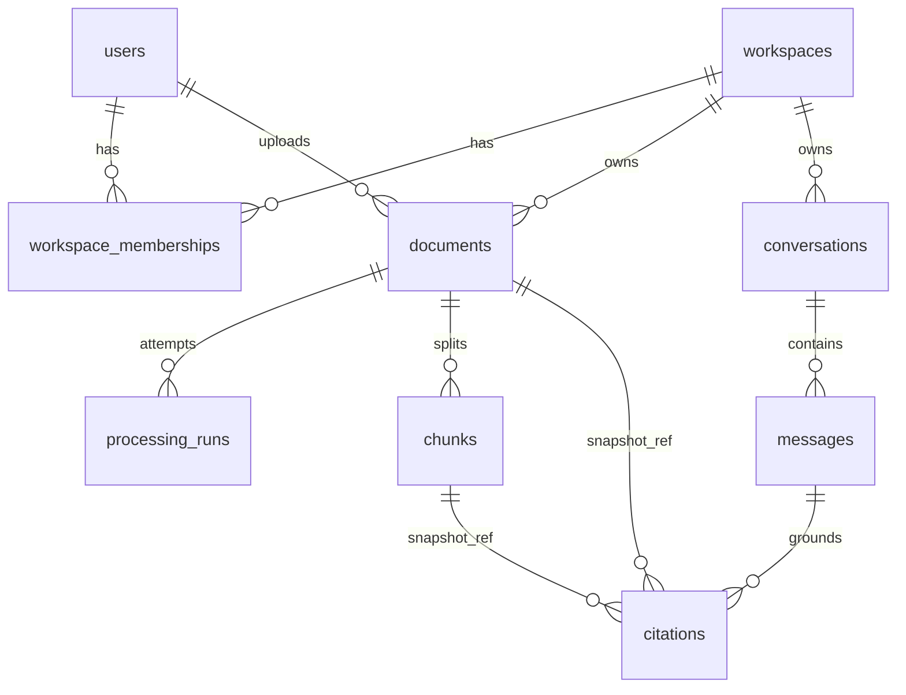

# Axiom — ERD + /api/v1 Draft (Phase 1, Step 3)

Scope: Phases 2–5 only (PDF text RAG v0.1). Later tables sketched in §10, not designed.

Legend: `[v0.1]` = mandatory for v0.1. `[later]` = explicitly deferred.

## 1. ERD



`snapshot_ref` is a non-enforced reference (no FK): the citation keeps working after the source row is gone.

## 2. Tables (v0.1)

All user-data tables carry `workspace_id` from creation. Server resolves it from membership, never from client input. UUID PKs everywhere.

**users** — `id, email UNIQUE NOT NULL, password_hash NOT NULL, created_at`. No FK to anything `[v0.1]`.

**workspaces** — `id, name NOT NULL, created_at`.

**workspace_memberships** — `user_id FK→users ON DELETE CASCADE, workspace_id FK→workspaces ON DELETE CASCADE, role ENUM(owner,admin,member,viewer), created_at`; PK `(user_id, workspace_id)` `[v0.1]`.

**documents** — `id, workspace_id FK→workspaces ON DELETE RESTRICT, uploaded_by (snapshot UUID, NO FK — see §4), original_filename, storage_key UNIQUE, mime_type, size_bytes, checksum, status ENUM(uploaded,queued,processing,retrying,indexed,failed), processing_attempts INT DEFAULT 0, error_code NULL, error_message NULL, created_at, updated_at, indexed_at NULL`; `UNIQUE(id, workspace_id)` (composite-FK target); `INDEX(workspace_id, status, created_at)`; `INDEX(workspace_id, checksum)` (dup warn, not unique — see §7) `[v0.1]`.

**processing_runs** — `id, document_id NOT NULL, workspace_id NOT NULL, attempt_no INT NOT NULL, stage TEXT NOT NULL, started_at, finished_at NULL, error_code/message NULL`; FK `(document_id, workspace_id) → documents(id, workspace_id) ON DELETE CASCADE` `[v0.1]`; `UNIQUE(document_id, attempt_no)` `[v0.1]`.

**chunks** — `id, document_id NOT NULL, workspace_id NOT NULL, chunk_index INT NOT NULL, content TEXT NOT NULL, page_number INT NULL, source_type TEXT DEFAULT 'text', chunk_version TEXT NOT NULL, embedding_model TEXT NOT NULL, embedding_dim INT NOT NULL, embedding VECTOR NOT NULL, created_at`; FK `(document_id, workspace_id) → documents(id, workspace_id) ON DELETE CASCADE` `[v0.1]`; `UNIQUE(document_id, chunk_index)` `[v0.1]`; `CHECK(chunk_index >= 0)` `[v0.1]`; `CHECK(embedding_dim > 0)` `[v0.1]`; `INDEX(workspace_id)` (exact filtered scan; no ANN in v0.1). `start_ts/end_ts` are `[later]` (audio/video, Phase 7).

**conversations** — `id, workspace_id FK→workspaces ON DELETE RESTRICT, created_by (snapshot UUID, NO FK — same rule as uploaded_by), title NULL, created_at`; `UNIQUE(id, workspace_id)`; `INDEX(workspace_id, created_at)` `[v0.1]`.

**messages** — `id, conversation_id NOT NULL, workspace_id NOT NULL, role ENUM(user,assistant), content TEXT NOT NULL, prompt_version NULL, model NULL, latency_ms NULL, tokens NULL, created_at`; FK `(conversation_id, workspace_id) → conversations(id, workspace_id) ON DELETE CASCADE` `[v0.1]`; `UNIQUE(id, workspace_id)`; `INDEX(conversation_id, created_at)` `[v0.1]`.

**citations** — `id, message_id NOT NULL, workspace_id NOT NULL, document_id NOT NULL (snapshot, NO FK — see §3), chunk_id NULL FK→chunks(id) ON DELETE SET NULL, original_filename TEXT NOT NULL (snapshot), page_number NULL, passage_text TEXT NOT NULL (snapshot), score NULL, created_at`; FK `(message_id, workspace_id) → messages(id, workspace_id) ON DELETE CASCADE` `[v0.1]`; `INDEX(message_id)` `[v0.1]`.

Reference implementation: `backend/app/db/models.py:1`. NOTE: models.py predates this review and does not yet contain `original_filename` on citations, the `processing_runs` unique constraint, the new CHECKs/indexes, or the corrected `ON DELETE` actions. Align it in Phase 2 migrations; the document above is authoritative.

## 3. Deletion policy [v0.1]

Goal: deleting a document removes the file and index but never deletes conversation history (US-07 + audit).

- `DELETE /documents/{id}` (admin+, terminal/cancellable states only — see §6) runs one transaction: delete storage object + `DELETE FROM documents WHERE id AND workspace_id`. Cascades remove `chunks` and `processing_runs` automatically. No worker may re-insert after this (guarded commit, §6).
- `citations.document_id` has NO foreign key, so deletion is never blocked and history is never cascade-deleted. Each citation already stores `document_id` (value), `original_filename`, `page_number`, and `passage_text`; all remain readable after deletion.
- `citations.chunk_id → chunks(id) ON DELETE SET NULL`: live citations can join the chunk; after deletion or re-index the id NULLs out but the snapshot (`passage_text`, page, filename) stays valid.
- `citations → messages ON DELETE CASCADE`: citations die only with their own conversation (message/conversation delete), never with the source document.
- `processing_runs` CASCADE with the document (operational history, not the audit trail). Permanent audit of who-deleted-what is `[later]` (`audit_logs`, Phase 10); v0.1 minimum is `updated_at` + error/status columns plus a server log line. Extension point: add `audit_logs` insert in the same delete transaction without changing FKs.

What is removed vs kept on document delete:

| Data | On document delete |
|---|---|
| Original file (storage object) | removed `[v0.1]` |
| `chunks` + vectors | removed via CASCADE `[v0.1]` |
| `processing_runs` | removed via CASCADE `[v0.1]` |
| `citations` (+ parent messages/conversations) | kept; `chunk_id` → NULL `[v0.1]` |

## 4. Workspace isolation and referential integrity [v0.1]

- `chunks(document_id, workspace_id) → documents(id, workspace_id)`: cross-workspace chunk attach is impossible at the DB level. Backed by `UNIQUE(documents.id, workspace_id)`.
- `messages(conversation_id, workspace_id) → conversations(id, workspace_id)` and `citations(message_id, workspace_id) → messages(id, workspace_id)`: same guarantee for chat history. Backed by the corresponding `UNIQUE(id, workspace_id)` constraints.
- `citations → documents` is intentionally NOT a foreign key (see §3). Trade-off: the DB cannot prove a citation's `document_id` belongs to the citation's workspace. Recommendation: enforce at write time — citations are created server-side in the same request/transaction that runs workspace-filtered retrieval, asserting `chunk.workspace_id == citation.workspace_id AND chunk.document_id == citation.document_id` before insert, plus a regression test. A trigger or composite-FK redesign was rejected for v0.1 as unnecessary machinery for a server-written table.
- `citations.chunk_id → chunks(id)` is single-column with `SET NULL` (not composite) for the same reason: a composite `(chunk_id, workspace_id, document_id)` FK would require NULLing all three on re-index, colliding with the `messages` FK on `workspace_id`. Existence is DB-enforced; workspace/document match is server-validated at write time.
- `documents.uploaded_by`, `conversations.created_by`: plain UUIDs, NO FK to `users` `[v0.1]`. Rationale: user lifecycle (delete/deactivate) is `[later]`; an FK would couple document survival to account management. Authorship is checked against live membership at request time, not via the FK.
- `documents.workspace_id`, `conversations.workspace_id → workspaces(id) ON DELETE RESTRICT`: workspace deletion is `[later]`; RESTRICT prevents accidental orphaning. Membership rows CASCADE with either parent.
- No redundant FKs: exactly one enforced path per parent-child pair listed in §2. Every `workspace_id` filter is additionally applied in application queries, including vector search (`WHERE workspace_id = :ws` before similarity ordering).

## 5. Permissions matrix [v0.1]

Least privilege. `owner` = `admin` for all v0.1 document/chat operations; the only owner/admin difference is workspace management `[later]` (members, billing, workspace delete). Membership and role checks are server-side per request; UI hiding is not enforcement.

| Action | viewer | member | admin | owner |
|---|---|---|---|---|
| List/read documents (`GET /documents`, `GET /documents/{id}`, `GET /documents/{id}/file`) | ✅ own workspace | ✅ | ✅ | ✅ (= admin) |
| Upload (`POST /documents`) | ❌ | ✅ | ✅ | ✅ |
| Chat + read own conversations (`POST /chat`, `GET /conversations/{id}`, `.../messages`) | ✅ own only | ✅ own only | ✅ any in workspace | ✅ any in workspace |
| Retry failed job (`POST /documents/{id}/retry`) | ❌ | ✅ | ✅ | ✅ |
| Delete document (`DELETE /documents/{id}`) | ❌ | ❌ | ✅ | ✅ |

Notes: conversations are private to their creator except admin/owner reads `[v0.1]`; shared workspace conversations are `[later]`. Cross-workspace IDs → `403/404` without leaking existence (use `404` for reads, `403` for writes the membership forbids — fixed per endpoint in §8, applied consistently).

## 6. Worker reliability and state transitions [v0.1]

Allowed transitions (actor in brackets):

```text
uploaded --[api upload / sweeper]--> queued --[worker claim]--> processing
processing --[worker: transient fail]--> retrying --[worker claim]--> processing
processing / retrying --[worker guarded commit]--> indexed
processing / retrying --[worker: permanent or attempts exhausted]--> failed
failed --[member+ POST retry, retryable only]--> queued (processing_attempts + 1)
uploaded / queued / indexed / failed --[admin+ DELETE]--> (row removed)
processing / retrying --[DELETE]--> 409 CONFLICT (delete blocked while worker owns the doc)
```

Rules:

1. Claim: worker starts only via conditional `UPDATE documents SET status='processing', processing_attempts=attempts+1, updated_at=now() WHERE id=:id AND workspace_id=:ws AND status IN ('queued','retrying') RETURNING *`. Zero rows → exit quietly (another worker/sweeper won) `[v0.1]`.
2. Guarded commit: chunks + status change in ONE transaction: `DELETE chunks WHERE doc` → `INSERT` new set (conflicts on `(document_id, chunk_index)` abort) → `UPDATE documents SET status='indexed' WHERE id AND status IN ('processing','retrying') AND processing_attempts=:claimed` → insert finished `processing_runs` row. Zero-row update → ROLLBACK (stale worker or concurrent delete wins; temp files cleaned, nothing re-inserted) `[v0.1]`.
3. Delete vs worker race: delete is `409` during `processing/retrying`, so the race window is claim-commit. If the row is gone at commit time, the FK + zero-row guard abort the transaction; the worker must not recreate the parent row `[v0.1]`.
4. Re-index/duplicate delivery: same task twice → one claim wins (§6.1); the loser exits. Retry re-runs the full txn in rule 2 (delete-then-insert), so no duplicate or mixed-version chunks. Embedding/model/dim of existing chunks is checked before reuse: mismatch aborts unless a full re-index flag is set (Phase 5 owns the flag; schema records the versions) `[v0.1]`.
5. Save-succeeded/enqueue-failed: v0.1 minimum safe behavior is row-first (`uploaded` committed), best-effort enqueue, plus the Phase 4 sweeper periodically moving stuck `uploaded`/`queued` and timed-out `processing` rows back to `queued`/`retrying`/`failed` under an attempt cap `[v0.1]`. A transactional outbox is `[later]`; extension point: add `outbox_events` insert to the upload transaction and a dispatcher, with no FK changes required.
6. Crash mid-task: no in-memory state is authoritative; sweeper + attempt cap is the only recovery path. Visibility timeout must exceed max task runtime (Phase 4 contract) `[v0.1]`.
7. Retry endpoint: only from `failed` with `retryable=true`; re-queues with `processing_attempts+1`, clears `error_code/message`, inserts a new `processing_runs` row. Double-clicking retry is idempotent (second call sees `queued`, returns `409`, no new attempt) `[v0.1]`.

## 7. Constraints, indexes, and pagination [v0.1]

Add only what v0.1 access patterns justify (no ANN index):

- `UNIQUE(processing_runs.document_id, attempt_no)` — one row per attempt (DB) `[v0.1]`.
- `UNIQUE(chunks.document_id, chunk_index)` + `CHECK(chunk_index >= 0)` — idempotent chunk sets (DB) `[v0.1]`.
- `CHECK(chunks.embedding_dim > 0)` (DB); exact model↔dim match validated app-side at index and query time, with a Phase 5 consistency test (no silent model mix) `[v0.1]`.
- `INDEX(documents.workspace_id, status, created_at)` — status-filtered lists; `ORDER BY created_at, id` with `limit default 20 max 100` for stable pagination `[v0.1]`.
- `INDEX(documents.workspace_id, checksum)` — duplicate-upload warning lookup (non-unique: warn and return existing, but allow intentional re-upload) `[v0.1]`. Trade-off: a UNIQUE constraint would enforce dedup strictly but block legitimate re-uploads of identical content under a new name; warning was chosen.
- `INDEX(chunks.workspace_id)` — workspace-filtered exact vector scan `[v0.1]`.
- `INDEX(conversations.workspace_id, created_at)`, `INDEX(messages.conversation_id, created_at)`, `INDEX(citations.message_id)` — history reads `[v0.1]`.
- Emails: app-lowercased + `UNIQUE`; `citext` is `[later]`.

## 8. /api/v1 contract [v0.1]

Base `/api/v1`, Bearer JWT, envelope `{error:{code,message,retryable,request_id}}`. `workspace_id` always from membership. New endpoint `GET /documents/{id}/file` is added because without it there is no authorized file-access path (frontend must never touch storage directly).

| Method | Endpoint | Role | Success | Errors | Scoping / state |
|---|---|---|---|---|---|
| `POST` | `/documents` (multipart PDF) | member+ | `202 {document_id, status:'queued'}` | `400 VALIDATION_ERROR` (type/size), `403 NOT_MEMBER`, `429 RATE_LIMITED` | workspace from token; row committed as `uploaded` then enqueued (§6.5) |
| `GET` | `/documents?status=&q=&limit=&offset=` | viewer+ | `200 {items, total}` ordered `(created_at,id)` | `403 NOT_MEMBER` | workspace-filtered; `q` matches filename only in v0.1 |
| `GET` | `/documents/{id}` | viewer+ | `200` metadata+status+error | `404 NOT_FOUND` (incl. other-workspace ids) | membership-checked |
| `GET` | `/documents/{id}/file` | viewer+ | `200` file stream | `404 NOT_FOUND`, `409 NOT_READY` (not indexed) | membership-checked; no storage paths leak |
| `POST` | `/documents/{id}/retry` | member+ | `202 {document_id, status:'queued'}` | `404`, `409 INVALID_STATE` (not `failed` / non-retryable / already `queued`), `403` | clears error, `attempts+1`, new run row |
| `DELETE` | `/documents/{id}` | admin+ | `204` | `404`, `409 CONFLICT` (in `processing/retrying`), `403` | txn per §3; file + cascades removed |
| `POST` | `/chat` `{conversation_id?, question, top_k?}` | viewer+ | `200 {message_id, answer, citations[{document_id,original_filename,page_number,passage_text,score}]}` or abstention `{answer, missing_evidence[]}` | `400/404` (bad/foreign conversation), `403`, `429` | retrieval filtered to workspace + `indexed` docs only; citations validated |
| `GET` | `/conversations/{id}` | viewer+ own, admin+ any | `200` | `403/404` | creator-or-admin/owner |
| `GET` | `/conversations/{id}/messages?limit=&offset=` | viewer+ own, admin+ any | `200 {items}` with citations | `403/404` | same rule; history survives doc delete (§3) |

## 9. Test checklist [v0.1] (all automated; deterministic parts gate CI)

1. Cross-workspace read: other-`ws` doc/conversation/message/citation/file → `404`, no existence leak (DB + authZ).
2. Cross-workspace write: retry/delete/chat on foreign ids → `403/404`; vector search never returns foreign chunks (isolation test, frozen corpus + local embedder).
3. Role matrix: viewer blocked from upload/retry/delete; member blocked from delete; admin paths pass.
4. Citation retention: delete doc → file + chunks + runs gone; conversation + citations readable with filename/page/passage intact, `chunk_id` NULL.
5. Deletion race: delete during `processing` → `409`; worker commit after delete → aborts, no resurrected rows/chunks.
6. Duplicate delivery: same task twice concurrently → exactly one claim, one chunk set (unique constraint holds).
7. Retry idempotency: double retry click → single re-queue; retry from non-`failed` → `409`.
8. Save-then-enqueue-fail: committed `uploaded` row recovered by sweeper in test (no outbox in v0.1).
9. Crash recovery: killed worker's `processing` row reaped to `retrying`/`failed` under attempt cap.
10. Embedding consistency: query with wrong model/dim rejected; mixed-version chunks never co-exist for one doc.
11. Citation validity: every cited chunk was in the retrieved set; injection PDF asserts instructions are quoted, not executed; unanswerable set measures abstention.
12. Pagination stability: repeated list reads with concurrent inserts return stable order `(created_at,id)`.

## 10. Later tables (sketched, not designed)

`solutions, proposals, proposal_versions, review_actions, workflow_runs` (Phase 8); `outbox_events` (only if §6.5 trigger met); `audit_logs` (Phase 10). No code may import them before their phase.
