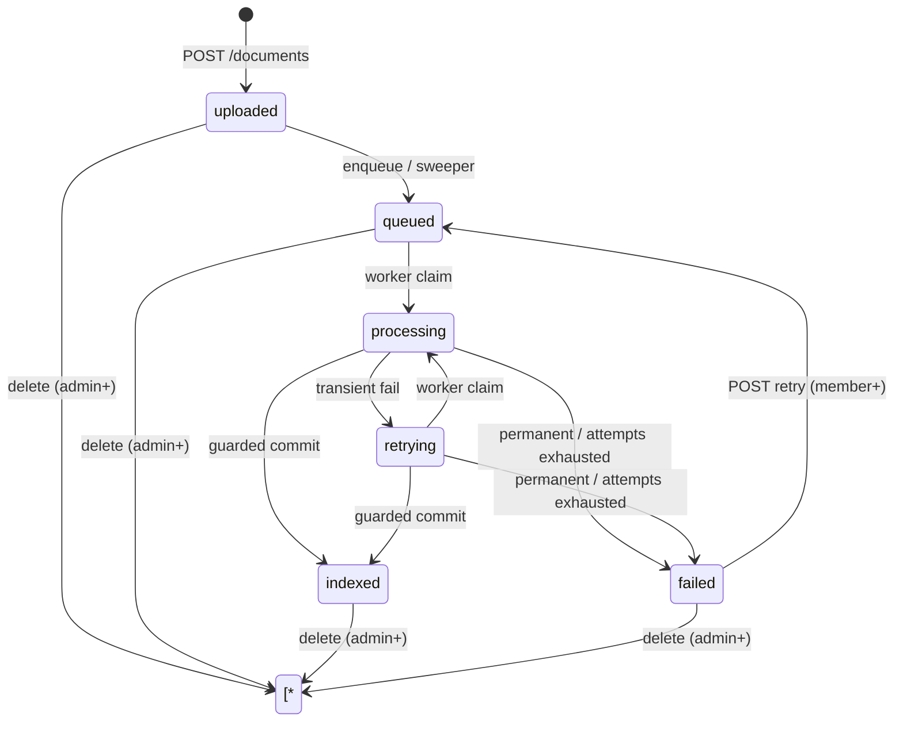

# Axiom — Document State Machine (Phase 1, Step 4)

Authoritative for v0.1 document lifecycle. Matches `03-erd-api.md §6` (worker contract); that section governs SQL/transaction detail, this file governs states and who may trigger each edge.

## States

`uploaded → queued → processing → retrying → indexed / failed`. Terminal queryable states: `indexed`, `failed`. `processing`/`retrying` are worker-owned. No other states in v0.1.

## Transition table [v0.1]

| From → To | Triggered by | Guard | Side effects |
|---|---|---|---|
| `∅ → uploaded` | API `POST /documents` (member+) | PDF validation, size/type/magic-byte checks pass | row committed, file stored, `processing_attempts=0` |
| `uploaded → queued` | API enqueue / Phase 4 sweeper | row exists, task published or re-enqueued | Celery task carries `document_id` only |
| `queued → processing` | worker claim | conditional `UPDATE ... WHERE status IN ('queued','retrying') RETURNING` wins; else exit | `attempts+1`, new `processing_runs` row opened |
| `retrying → processing` | worker claim | same claim guard | same as above |
| `processing → retrying` | worker | transient error (timeout, rate-limit, provider 5xx) AND attempts < cap | run row closed with `error_code`, backoff scheduled |
| `processing/retrying → indexed` | worker guarded commit | single txn: replace chunk set + conditional status update on `(id, claimed_attempts)`; zero rows → rollback | `indexed_at` set, error cleared |
| `processing/retrying → failed` | worker | permanent error (corrupt/empty/unsupported) OR attempts exhausted | `error_code/message` set (`retryable` flag decides retry eligibility) |
| `failed → queued` | API `POST /documents/{id}/retry` (member+) | from `failed` AND `retryable=true`; double-click → second call sees `queued` → `409` | error cleared, `attempts+1`, new run row |
| `uploaded/queued/indexed/failed → deleted` | API `DELETE /documents/{id}` (admin+) | not in `processing/retrying` | storage object + row removed; chunks/runs cascade; citations keep snapshots |

## Illegal transitions (all → `409 INVALID_STATE`) [v0.1]

- `POST retry` from any state except `failed`, or when `retryable=false`.
- `DELETE` while in `processing`/`retrying` (`409 CONFLICT` — worker owns the doc).
- Worker commit/claim against a state it did not claim (stale worker → zero-row update → rollback, never a force-write).
- Any client-supplied `status` field: status is server-derived only; requests carrying it are `400 VALIDATION_ERROR`.

## Delete vs search visibility

Only `indexed` documents are searchable. `uploaded/queued/processing/retrying/failed` rows are never cited. After delete, citations survive as snapshots (`original_filename`, `page_number`, `passage_text`; `chunk_id` NULL) per `03-erd-api.md §3`.

## Invariants / enforcement

- DB: `status` ENUM, `UNIQUE(document_id, chunk_index)`, `UNIQUE(document_id, attempt_no)`, composite FKs (03 §7).
- Server: transition allow-list above; role checks (retry member+, delete admin+).
- Txn: claim + guarded commit + sweeper recovery (03 §6).
- Tests: 03 §9 items 5–9 (deletion race, duplicates, retry idempotency, sweeper recovery, crash recovery).
