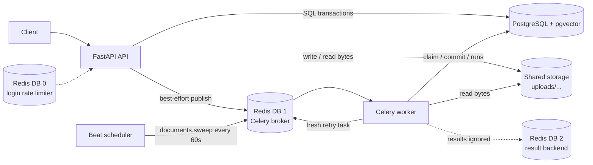

# Axiom — Understanding Phase 4 (Background Processing)

> **Who this is for.** You have the project and you want to *understand* how a document becomes a background job, how a worker claims it, and how the system recovers when a process dies or Redis disappears. This document explains the implemented Phase 4 lifecycle, the transaction boundaries that keep it correct, and the failure drills that prove it.
>
> **How to use it.** Read §1–§4 first (the story and the architecture). Then read the claim and guarded-commit sections with the SQL beside the code. The drills in §11 are the fastest way to see the design behave under failure. The code-reading path is in §14; the exercises that test your understanding are in §15.
>
> The operational README stays in [`README.md`](../../README.md). This guide is about *why* the implementation looks the way it does.

---

## 1. The one-sentence version

Phase 4 turned a committed `queued` row into **an idempotent, crash-recoverable background job**: exactly one worker claims it, the processor runs outside the claim transaction, a guarded commit persists the result, and a periodic sweeper repairs every state a lost Redis message, a dead worker, or a failed publish can leave behind.

One qualification matters for reading the rest of this guide: the Phase 4 processor is an **integrity processor**, not a PDF indexer. It verifies the stored bytes and returns zero chunks. `indexed` therefore means "the Phase 4 lifecycle completed"; it does not yet mean "text and embeddings exist". Phase 5 replaces the processor and backfills the documents that were indexed with no chunks.

---

## 2. The problem Phase 4 solves

Phase 3 ended with two durable facts:

1. the bytes are at `uploads/{document_id}/original.pdf`;
2. a PostgreSQL row says `queued`.

Nothing consumed that row. Phase 4 adds the consumer, but the consumer crosses three failure boundaries that a request handler does not have:

| Boundary | What can go wrong | Why it cannot be solved by one transaction |
|---|---|---|
| API → broker | The row commits, then the publish fails or the process dies before publishing | PostgreSQL and Redis do not share a transaction |
| broker → worker | Redis delivers the same task twice, or loses it entirely | At-least-once delivery is the only practical guarantee; Redis is not the system of record |
| worker → filesystem | The worker dies while reading, while inserting chunks, or after committing but before acknowledging | The file read is slow and cannot hold a row lock; the database transaction ends before the task ends |

The design answer is deliberately conservative:

- **PostgreSQL is authoritative.** Status, attempts, runs, errors, and chunks live there. Redis carries messages, never truth.
- **The claim is a conditional UPDATE.** One worker wins; duplicate delivery is harmless.
- **Processing happens outside the claim transaction.** A slow disk read does not hold a document row lock.
- **The commit is guarded by the claim identity.** A worker that lost its claim cannot overwrite a newer attempt.
- **The sweeper re-derives work from state.** Any message the broker loses is recoverable by looking at the database, not by replaying a Redis log.
- **Failure is classified, not guessed.** Transient, permanent-fixable, and permanent-final errors lead to different states and different retry permissions.

The accepted trade-off is **delay**: a lost message is recovered on the next sweep, not instantly. Phase 4 chooses bounded delay and simple invariants over a transactional outbox. The outbox remains a documented extension point (D-004), not part of v0.1.

---

## 3. Architecture

### 3.1 Components



The important arrows are not the happy path. They are the two that do **not** exist:

- there is no arrow from Redis back into PostgreSQL that makes a Redis message authoritative;
- there is no arrow from the worker to the API that reports success. The document row is the report.

### 3.2 Services and responsibilities

| Component | Phase 4 responsibility |
|---|---|
| FastAPI | Commits the upload row, publishes one task after the commit, retries a failed document, blocks deletion while a worker owns it |
| PostgreSQL | Source of truth for document state, attempt counter, run history, chunks, and retryability |
| Celery worker | Claims a document, runs the processor outside the transaction, commits or classifies failure |
| Celery Beat | Enqueues `documents.sweep` on a fixed interval; the sweeper itself owns the stale thresholds |
| Redis DB 0 | Login rate limiting only; independent of task processing |
| Redis DB 1 | Celery broker; losing it loses messages, not documents |
| Redis DB 2 | Celery result backend; configured so Celery never silently falls back, but results are ignored |
| Shared storage | The API writes bytes; the worker reads the same bind-mounted root |

### 3.3 Why three Redis databases?

The rate limiter and Celery must not delete or evict each other's keys. The defaults inside Compose are:

```text
REDIS_URL              redis://redis:6379/0   login rate limiter
CELERY_BROKER_URL      redis://redis:6379/1   task transport
CELERY_RESULT_BACKEND  redis://redis:6379/2   task results (unused by the lifecycle)
```

If `CELERY_BROKER_URL` or `CELERY_RESULT_BACKEND` is blank, `Settings._resolve_celery_urls()` derives it from `REDIS_URL` by replacing the database number with `1` or `2`. An explicit URL is honoured, so a deployment can point Celery at another Redis instance without moving the rate limiter.

`task_ignore_result=True` is set in `app/worker/celery_app.py`. The result backend is still configured on purpose: a blank backend would make Celery fall back to a transport it can reach, and the deployment would look healthy while storing results somewhere nobody intended. The lifecycle never reads a result.

---

## 4. The lifecycle

### 4.1 States

```mermaid
stateDiagram-v2
    [*] --> queued: POST /documents commits row
    [*] -.-> uploaded: supported recovery state<br/>(not produced by current API)
    uploaded --> queued: sweeper
    queued --> processing: worker claim
    retrying --> processing: worker claim
    processing --> retrying: transient failure<br/>and claims remain
    processing --> indexed: guarded commit
    retrying --> indexed: guarded commit
    processing --> failed: permanent failure<br/>or claims exhausted
    retrying --> failed: permanent failure<br/>or claims exhausted
    queued --> failed: sweeper finds attempts at cap
    retrying --> failed: sweeper finds attempts at cap
    failed --> queued: POST retry<br/>(retryable only)
    uploaded --> [*]: admin delete
    queued --> [*]: admin delete
    indexed --> [*]: admin delete
    failed --> [*]: admin delete
```

`processing` and `retrying` are worker-owned. Deletion is refused while a document is in either state. `indexed` and `failed` are terminal for the worker; `failed` can return to `queued` only through the explicit retry endpoint and only when `documents.retryable` is true.

`uploaded` is part of the enum and the sweeper, but **the current upload path never creates it**. Phase 3's single-commit handoff was kept: the row is committed directly as `queued`, then published. The `uploaded` rule remains as a supported recovery state for any deployment or future writer that uses the split. This is recorded as D-016.

### 4.2 Happy path

```mermaid
sequenceDiagram
    autonumber
    participant C as Client
    participant A as API
    participant D as PostgreSQL
    participant S as Storage
    participant R as Redis (broker)
    participant W as Worker
    participant B as Beat

    C->>A: POST /api/v1/documents (multipart PDF)
    A->>A: validate, compute SHA-256, dedup
    A->>S: save uploads/{id}/original.pdf
    A->>D: INSERT document status=queued, attempts=0; COMMIT
    A->>R: documents.process(document_id) — best effort
    A-->>C: 202 {document_id, status: queued}

    R->>W: deliver task
    W->>D: claim UPDATE ... RETURNING; INSERT processing_runs; COMMIT
    W->>S: read original.pdf
    W->>W: verify checksum and PDF signature
    W->>D: DELETE old chunks; INSERT new chunks; UPDATE indexed; close run; COMMIT
    Note over B,D: Every 60s, Beat enqueues documents.sweep.<br/>The sweeper repairs rows that no task reached.
```

### 4.3 The numbered lifecycle

1. **Upload.** `ingest_upload()` validates the PDF, computes the checksum, performs the advisory duplicate lookup, saves the file, and commits the row as `queued` with `processing_attempts=0`.
2. **Publish.** The route calls `TaskPublisher.enqueue_document(document_id)`. A failed publish is logged and ignored; the committed row is the durable fact.
3. **Claim.** The worker validates the payload, opens a database session, and calls `claim_document()`. The claim resolves the workspace, performs the conditional UPDATE, and inserts a `processing_runs` row in the same transaction.
4. **Process.** `_run_processor()` copies the immutable claim facts into a `DocumentSnapshot`, gets the configured processor and storage adapter, and runs outside any database transaction.
5. **Commit.** `commit_success()` replaces the chunk set, guards the document update on the claimed attempt, closes the run row, and commits.
6. **Retry.** `handle_failure()` classifies the error, persists `retrying` or `failed`, closes the run row, and returns a countdown when another automatic attempt is allowed. The task layer publishes a **fresh** task after the state transition commits.
7. **Sweep.** Beat enqueues `documents.sweep`. The sweeper recovers stale `uploaded`, `queued`, `retrying`, and `processing` rows under an advisory lock.
8. **Acknowledge.** Celery acknowledges the task after the function returns (`task_acks_late=True`). The database state, not the acknowledgement, decides whether the work is done.

### 4.4 Who writes which table

| Table | Writer | What it records |
|---|---|---|
| `documents` | API, worker, sweeper | Current state, attempt count, retryability, current error |
| `processing_runs` | Worker claim, worker commit/failure, sweeper timeout | One row per claim: `claimed`, `indexed`, `retrying`, `failed`, or `timeout` |
| `chunks` | Worker guarded commit | The processor output for the current successful attempt |
| `citations` | Future retrieval/chat layer | Snapshots that survive document deletion; not written in Phase 4 |

The run row is **operational history**, not an audit log. It is deleted with its document. It exists so an operator can answer "was attempt 3 claimed? did it time out? did it commit?" without guessing from the final state.

---

## 5. The claim

### 5.1 SQL

`claim_document()` performs a `SELECT`, an `UPDATE`, and an `INSERT` in one transaction:

```sql
-- 1. Resolve the workspace. The task payload carries only document_id.
SELECT workspace_id
FROM documents
WHERE id = :document_id;

-- 2. Claim exactly one queued/retrying row, if the budget allows.
UPDATE documents
SET status = 'processing',
    processing_attempts = processing_attempts + 1,
    updated_at = now(),
    error_code = NULL,
    error_message = NULL,
    retryable = false
WHERE id = :document_id
  AND workspace_id = :workspace_id
  AND status IN ('queued', 'retrying')
  AND processing_attempts < :max_attempts
RETURNING id, workspace_id, processing_attempts, storage_key, checksum,
          size_bytes, mime_type, original_filename;

-- 3. Open the run row in the same transaction.
INSERT INTO processing_runs
    (id, document_id, workspace_id, attempt_no, stage, started_at)
VALUES
    (:run_id, :document_id, :workspace_id, :claimed_attempt, 'claimed', now());
```

If the `SELECT` finds no row, the function rolls back and returns `None`. If the `UPDATE` returns no row, it rolls back and returns `None`. If the run insert fails, the exception is re-raised after a rollback, so the document is claimable again.

### 5.2 Why the workspace is resolved first

The task payload is only `document_id` (D-017). The workspace is not trusted from the message, and it is not carried in a separate argument that could drift from the row. The claim reads it from PostgreSQL and then repeats it in the UPDATE's WHERE clause. That keeps the transition scoped exactly like the Phase 1 contract and gives the run row its workspace snapshot.

A cross-workspace document id in a forged message therefore claims nothing: the row's own `workspace_id` is the one used.

### 5.3 Exactly one winner

PostgreSQL row locking supplies the mutual exclusion:

1. Both workers execute the `UPDATE` against the same row.
2. The first transaction locks the row and changes it to `processing`.
3. The second waits, then re-evaluates the predicate against the committed row.
4. `status IN ('queued','retrying')` is now false, so the second UPDATE matches zero rows.

The loser returns `None` and performs no side effects. It does not close the winner's run row, does not remove chunks, and does not publish another task. This is what makes at-least-once delivery safe.

`tests/test_worker_claim_concurrency.py` exercises this with two real connections; `tests/test_worker_pipeline.py` covers the no-op cases (missing row, wrong state, attempt cap, duplicate delivery, deleted row).

### 5.4 Attempt semantics

`processing_attempts` counts **claims**, not uploads and not manual retry clicks.

- A new upload starts at `0`.
- The first worker claim sets it to `1`.
- A transient failure followed by a fresh task and a new claim sets it to `2`.
- `POST /documents/{id}/retry` does **not** increment it. The endpoint moves `failed → queued`; the next claim consumes the next attempt.
- The cap is checked in the claim (`processing_attempts < max_attempts`), so a fifth claim is allowed and a sixth is not.

This is the key reconciliation with the Phase 1 draft. The draft said the retry endpoint incremented the counter; the implementation deliberately does not (D-018). Incrementing on retry would let a user bypass the failure budget by clicking retry before the worker ever ran, and the counter would no longer mean "attempts a worker actually started".

A consequence follows: a manual retry of a document whose counter is already at the cap can be accepted by the endpoint (the row is `failed` and `retryable`), but no claim can win. The queued row is then failed by the sweeper as `ATTEMPTS_EXHAUSTED`. This is consistent with the cap being a hard budget; it does not reset the counter to make a click succeed.

---

## 6. The processing port and the integrity processor

### 6.1 The port

`app/processing/base.py` defines the seam:

```python
class DocumentProcessor(Protocol):
    def process(self, snapshot: DocumentSnapshot, storage: FileStorage) -> ProcessResult: ...
```

`DocumentSnapshot` carries only the facts a processor needs: `id`, `workspace_id`, `storage_key`, `checksum`, `size_bytes`, `mime_type`. A snapshot is passed instead of an ORM `Document` so the processor cannot lazy-load relationships, mutate the row, or depend on a live session.

`ProcessResult` carries a tuple of `NewChunk`. The pipeline—not the processor—assigns `document_id`, `workspace_id`, `chunk_index`, and `created_at` at commit time. That keeps identity and placement in one place and lets the processor be tested without PostgreSQL, Redis, or Celery.

### 6.2 What the Phase 4 processor does

`IntegrityProcessor` in `app/processing/integrity.py`:

1. reads the object through `FileStorage.read(storage_key)`;
2. rejects an empty object (`EMPTY_FILE`);
3. compares the SHA-256 digest to the uploaded checksum with `hmac.compare_digest` (`CHECKSUM_MISMATCH`);
4. rejects content that does not start with `%PDF-` (`INVALID_PDF`);
5. returns `ProcessResult(chunks=())`.

The order is fixed so the failure code is deterministic. It deliberately does not extract text, count pages, split chunks, or generate embeddings. That is Phase 5 work.

Storage exceptions are translated at this boundary, not in the task wrapper:

| Storage condition | Processing error | Classification |
|---|---|---|
| `StorageNotFoundError` | `FileMissing` | permanent-fixable |
| `StoragePathError` | `StoragePathInvalid` | permanent-final |
| `StorageUnavailableError` caused by `PermissionError` | `StoragePermissionDenied` | permanent-fixable |
| other `StorageUnavailableError` | `StorageUnavailable` | transient |
| leaked `OSError` | `StorageIOError` | transient |

The permission case is deliberately not transient: a mode or mount problem will keep failing until an operator repairs it. The taxonomy is in `app/processing/errors.py`.

### 6.3 Why `indexed` can mean zero chunks

The guarded commit is processor-agnostic. It deletes the old chunk set, inserts whatever the processor returned, and marks the document indexed. The integrity processor returns an empty tuple, so a successful Phase 4 document has **zero chunk rows**.

That is acceptable for Phase 4 because the milestone's acceptance criterion is the lifecycle, not retrieval. It is not acceptable for Phase 5, which must replace the processor and backfill those documents before retrieval can treat `indexed` as searchable evidence. The handoff is in §17.

---

## 7. The guarded commit

### 7.1 SQL

`commit_success()` runs one transaction:

```sql
BEGIN;

-- 1. Remove the previous attempt's chunk set.
DELETE FROM chunks
WHERE document_id = :document_id
  AND workspace_id = :workspace_id;

-- 2. Insert the new set. The flush surfaces a duplicate
--    (document_id, chunk_index) as a chunk conflict.
INSERT INTO chunks
    (id, document_id, workspace_id, chunk_index, content, page_number,
     source_type, chunk_version, embedding_model, embedding_dim,
     embedding, created_at)
VALUES (...);

-- 3. The stale-worker barrier: only the worker that owns this attempt may win.
UPDATE documents
SET status = 'indexed',
    indexed_at = now(),
    updated_at = now(),
    error_code = NULL,
    error_message = NULL,
    retryable = false
WHERE id = :document_id
  AND workspace_id = :workspace_id
  AND status IN ('processing', 'retrying')
  AND processing_attempts = :claimed_attempt
RETURNING id;

-- 4. Close the run row for this attempt.
UPDATE processing_runs
SET stage = 'indexed',
    finished_at = now()
WHERE document_id = :document_id
  AND workspace_id = :workspace_id
  AND attempt_no = :claimed_attempt
  AND finished_at IS NULL;

COMMIT;
```

If step 3 returns no row, the whole transaction—including the DELETE and INSERT from steps 1 and 2—rolls back. The previous chunk set remains visible and no partial new set is committed. The worker logs `document.stale_commit` and returns `false`.

If the INSERT in step 2 raises an `IntegrityError` (most commonly a duplicate `(document_id, chunk_index)`), the pipeline rolls back and raises `ChunkConflict`; the task layer classifies it as permanent-final. A deterministic conflict will not be fixed by retrying the same commit.

### 7.2 Why the attempt number is in the predicate

Status alone is not enough. Consider this sequence:

1. Worker A claims attempt 1.
2. A's task stalls longer than the sweeper's `processing` threshold.
3. The sweeper moves the row to `retrying`, publishes a fresh task.
4. Worker B claims attempt 2 and starts processing.
5. Worker A wakes up and tries to commit.

Without the `processing_attempts = :claimed_attempt` guard, A's UPDATE would match `status='processing'` and overwrite B's work. With the guard, A's predicate sees `processing_attempts=2`, matches zero rows, and rolls back. The row is still owned by B.

The same barrier protects the failure path. `handle_failure()` guards the document update and the run-row close with the same attempt identity; if either matches zero rows, the whole transaction rolls back and returns `STALE`. A worker that lost its claim cannot write an error over a newer attempt.

### 7.3 The deletion race

Deletion is refused while the row is `processing` or `retrying`, so the dangerous window is between the claim-commit and the delete. The delete route:

1. loads the document `FOR UPDATE`;
2. refuses `processing`/`retrying` with `409`;
3. deletes and flushes the row;
4. removes the storage object;
5. commits.

If a worker's claim has already committed, the delete sees `processing` and refuses. If the delete wins first, the worker's guarded UPDATE matches zero rows and rolls back; the FK would also reject a chunk insert against a missing parent. The worker never recreates the document.

### 7.4 Run-row lifecycle

| Event | `processing_runs` row |
|---|---|
| Claim | inserted with `stage='claimed'`, `started_at=now()` |
| Guarded commit | updated to `stage='indexed'`, `finished_at=now()` |
| Transient failure | updated to `stage='retrying'`, error code/message, `finished_at=now()` |
| Permanent failure | updated to `stage='failed'`, error code/message, `finished_at=now()` |
| Sweeper timeout | updated to `stage='timeout'`, `PROCESSING_TIMEOUT`, `finished_at=now()` |
| Document delete | removed by `ON DELETE CASCADE` |

A retrying run row is **closed**. The next attempt gets a new row with its own `attempt_no`. This is why `UNIQUE(document_id, attempt_no)` is safe and why a manual retry does not insert a run row: the row is created by the claim that actually starts work.

---

## 8. Failure classification and retries

### 8.1 Two independent axes

Every processor failure is classified on two axes:

- **`transient`** — the same input may succeed later without human intervention. Only these are retried automatically.
- **`retryable`** — the manual retry endpoint may re-queue the document from `failed`.

The combination gives three families:

| Family | `transient` | `retryable` | Automatic retry | Manual retry |
|---|---|---|---|---|
| `TransientProcessingError` | yes | yes | while claims remain | yes |
| `PermanentFixableError` | no | yes | no | yes, after repair |
| `PermanentFinalError` | no | no | no | no |

### 8.2 Error taxonomy

| Code | Class | `transient` | `retryable` | Typical cause |
|---|---|---|---|---|
| `STORAGE_UNAVAILABLE` | `StorageUnavailable` | yes | yes | storage backend unreachable |
| `STORAGE_IO_ERROR` | `StorageIOError` | yes | yes | leaked OS error during read |
| `PROCESSING_TIMEOUT` | `ProcessingTimeout` | yes | yes | soft time limit exceeded |
| `FILE_MISSING` | `FileMissing` | no | yes | row exists, object does not |
| `STORAGE_PERMISSION_DENIED` | `StoragePermissionDenied` | no | yes | mode or mount repair needed |
| `CHUNK_CONFLICT` | `ChunkConflict` | no | no | duplicate `(document_id, chunk_index)` |
| `STORAGE_PATH_INVALID` | `StoragePathInvalid` | no | no | malformed or escaping key |
| `CHECKSUM_MISMATCH` | `ChecksumMismatch` | no | no | bytes changed after upload |
| `INVALID_PDF` | `InvalidPdf` | no | no | bytes are not a PDF |
| `EMPTY_FILE` | `EmptyFile` | no | no | zero-byte object |
| `INTERNAL_ERROR` | `InternalError` | no | no | unexpected processor exception |
| `ATTEMPTS_EXHAUSTED` | generated by pipeline/sweeper | — | no | transient failure at the claim cap |

`ATTEMPTS_EXHAUSTED` is not a `ProcessingError` subclass: it is the state the pipeline writes when a transient failure has no claim left. Its safe message is "Document processing failed after the maximum number of attempts."

Only `safe_message` is persisted or shown to a client. The exception chain (`raise ... from exc`) preserves the internal cause for logs without leaking a path, a provider response, or user input through the API.

### 8.3 The decision path

```text
processor raises ProcessingError
        |
        +-- transient AND attempt < max?
        |       yes -> status=retrying
        |              error=code
        |              retryable=true
        |              run.stage=retrying, finished_at=now()
        |              publish fresh task with countdown
        |
        +-- transient AND attempt == max?
        |       -> status=failed
        |          error=ATTEMPTS_EXHAUSTED
        |          retryable=false
        |          run.stage=failed
        |
        +-- permanent-fixable?
        |       -> status=failed
        |          error=code
        |          retryable=true
        |          run.stage=failed
        |
        +-- permanent-final?
                -> status=failed
                   error=code
                   retryable=false
                   run.stage=failed
```

`SoftTimeLimitExceeded` is converted to `ProcessingTimeout` before classification. A `SQLAlchemyError` is **not** converted: the pipeline rolls back and the task re-raises it so Celery records a database failure and the document remains for the sweeper. Hiding a database outage as a document failure would consume the document's attempt budget for an infrastructure problem.

### 8.4 Backoff

`compute_backoff()`:

```text
countdown = min(base * 2^(attempt - 1) + uniform(0, jitter), maximum)
```

With the defaults (`base=30`, `jitter=10`, `maximum=900`):

| Claimed attempt | Base delay | Jittered delay (seconds) | Used? |
|---|---|---|---|
| 1 | 30 s | 30–40 | yes, after a transient failure |
| 2 | 60 s | 60–70 | yes |
| 3 | 120 s | 120–130 | yes |
| 4 | 240 s | 240–250 | yes |
| 5 | 480 s | 480–490 | **no** — the fifth transient failure is at the cap and becomes `failed` |

The jitter is added before the maximum is applied, so the result never exceeds `maximum` even with a large random draw. Tests inject a fixed `RandomSource` to make the table deterministic; production uses `random.SystemRandom()`, which has no inherited state across prefork children.

**Backoff applies only to automatic retries.** The manual retry endpoint moves `failed → queued` immediately. It does not schedule a countdown and does not reset the attempt counter.

### 8.5 Publishing the next attempt

The task layer never calls `self.retry()`. `handle_failure()` commits the `retrying` state first, then `process_document()` publishes a **new** task with the computed countdown:

```python
failure = handle_failure(...)
if failure.status is FailureStatus.RETRYING:
    published = get_task_publisher().enqueue_document(
        claim.id,
        countdown=failure.countdown or 0,
    )
```

If the publish fails, the row is already `retrying` and the sweeper will publish it after `SWEEPER_RETRYING_STALE_SECONDS`. `self.retry()` was rejected because it makes Celery's retry state the source of truth and ties the retry schedule to the worker that happened to fail.

### 8.6 Stale failures

A worker that lost its claim may still be running. When it finally fails, `handle_failure()` matches zero rows and returns `STALE`. The task returns `"stale"` without writing an error or publishing a retry. The current owner—worker B or the sweeper—is responsible for the row.

This is the failure-path counterpart of the guarded commit. Both are tested by manipulating the attempt counter between claim and write.

---

## 9. The sweeper

### 9.1 Why a state-based sweeper

Redis loses messages. Workers die. A publish can fail after the database commit. A transactional outbox would solve the first window by writing an outbox row in the same transaction as the state change, then dispatching it. It would not solve a worker that dies mid-task or a broker that loses an already-published message. The Phase 4 sweeper reads the authoritative database and repairs all four windows:

```text
uploaded  -> queued + publish
queued    -> publish (or fail at cap)
retrying  -> publish (or fail at cap)
processing -> retrying + publish (or fail at cap)
```

The cost is latency: recovery happens on the sweep interval, not immediately. The benefit is that there is no second source of truth to reconcile.

### 9.2 Rules

| Stale state | Threshold (default) | Below the attempt cap | At the attempt cap |
|---|---|---|---|
| `uploaded` | 300 s | conditional `uploaded → queued`, then publish | the queued transition and publish still happen; the queued rule fails it on a later sweep |
| `queued` | 600 s | publish, status unchanged | `failed`, `ATTEMPTS_EXHAUSTED`, `retryable=false` |
| `retrying` | 600 s | publish, status unchanged | `failed`, `ATTEMPTS_EXHAUSTED`, `retryable=false` |
| `processing` | 900 s | `retrying`, `PROCESSING_TIMEOUT`, `retryable=true`, close open run as `timeout`, publish | `failed`, `ATTEMPTS_EXHAUSTED`, `retryable=false`, close open run as `timeout` |

Thresholds are measured with PostgreSQL's `now()`, not the worker host's clock:

```sql
WHERE status = :status
  AND updated_at < now() - make_interval(secs => :stale_seconds)
ORDER BY updated_at ASC, id ASC
LIMIT :batch_size + 1;
```

One extra row is fetched only to report `more_remaining`; the batch work is limited to `batch_size` per category. The default is 100 per category, so one sweep can scan up to 400 rows and publish up to 400 tasks.

### 9.3 Transitions are conditional

Selection is not a lock. Between the `SELECT` and the `UPDATE`, a worker can claim the row, a user can delete it, or another sweeper can recover it. Every transition repeats its guards:

```sql
-- uploaded -> queued
UPDATE documents
SET status = 'queued',
    error_code = NULL,
    error_message = NULL,
    retryable = false
WHERE id IN (:ids)
  AND status = 'uploaded'
RETURNING id;

-- queued/retrying at the cap -> failed
UPDATE documents
SET status = 'failed',
    error_code = 'ATTEMPTS_EXHAUSTED',
    error_message = 'Document processing failed after the maximum number of attempts.',
    retryable = false,
    updated_at = now()
WHERE id IN (:ids)
  AND status = :status
  AND processing_attempts >= :max_attempts
RETURNING id;
```

For stale processing rows, a single `CASE` expression chooses `retrying` or `failed` and preserves `updated_at` for the retrying branch:

```sql
UPDATE documents
SET status = CASE
        WHEN processing_attempts < :max_attempts THEN 'retrying'
        ELSE 'failed'
    END,
    error_code = CASE
        WHEN processing_attempts < :max_attempts THEN 'PROCESSING_TIMEOUT'
        ELSE 'ATTEMPTS_EXHAUSTED'
    END,
    retryable = (processing_attempts < :max_attempts),
    updated_at = CASE
        WHEN processing_attempts < :max_attempts THEN updated_at
        ELSE now()
    END
WHERE id IN (:ids)
  AND status = 'processing';
```

The open run rows for those documents are closed in the same transaction with `stage='timeout'`, `error_code='PROCESSING_TIMEOUT'`, and `finished_at=now()`.

### 9.4 State first, publish second

The sweep commits all state transitions **before** the first publish:

```text
select candidates
  -> conditional transitions
  -> close runs
  -> COMMIT
  -> publish each task independently
  -> on success, update updated_at with a status guard
  -> COMMIT
```

Why this order:

- if the process dies after the commit but before publishing, the next sweep sees the same rows and publishes again;
- if the process dies mid-publish, only the unpublished rows remain stale;
- a published task can never observe an uncommitted transition;
- a publish failure is counted and logged, not raised, so one broker error does not abort the rest of the batch.

`updated_at` is the retry marker for non-terminal states. The sweeper touches it only **after** a successful publish, with a status guard. A row that was claimed or changed since selection no longer matches the guard, so the touch leaves it alone. A failed publish leaves the old timestamp, so the next sweep tries again.

### 9.5 Advisory lock

Beat can run multiple schedulers, and a deployment can run many workers. The sweeper must not have two instances publishing the same batch. It uses a PostgreSQL **session-level** advisory lock on a dedicated connection:

```sql
SELECT pg_try_advisory_lock(1096306509);   -- 0x41584F4D, "AXOM"
-- ... run the sweep on a different connection ...
SELECT pg_advisory_unlock(1096306509);
```

Properties that matter:

- `pg_try_advisory_lock` returns immediately; a busy lock is an empty `SweepSummary`, not an error and not a queue.
- The lock is session-level, so the short transaction that acquires it can commit without releasing it. The sweep session is a different connection and cannot release the lock by committing.
- The lock is released in a `finally` block.
- If `pg_advisory_unlock` fails or reports that the lock was not held, the connection is **invalidated**. A pooled connection that still holds a session-level lock would block every future sweep even after the task returned.
- The key is visible in `pg_locks.objid`, which makes a stuck lock diagnosable from `psql`.

The lock is per PostgreSQL database, not per worker or per Beat instance. Two Compose projects pointed at the same database contend with each other, which is the intended behavior.

### 9.6 Summary and logs

`SweepSummary` reports `scanned`, `recovered`, `failed`, `publish_failures`, `more_remaining`, and `duration_ms`. The task logs one `sweeper.summary` line. A lock contention logs `sweeper.lock_busy`; a publish failure logs `sweeper.publish_failed` with the document id and status.

A sweep is idempotent: re-running it changes nothing once the rows have moved, and a duplicate publish is harmless because the claim guard admits one worker.

---

## 10. API integration

### 10.1 Upload

`upload_document()` calls `ingest_upload()`, then publishes only when the result is not a duplicate:

```python
if not result.duplicate:
    _publish_document(publisher, result.document.id, result.document.status)
```

`_publish_document()` logs a warning and returns when the publisher reports `False`. It never turns a broker failure into an API error: the row is already committed as `queued`, and the sweeper owns recovery. The upload response is still `202` for a new document and `200` for a duplicate.

A duplicate does not publish. Returning the existing row and starting another task for the same bytes would create duplicate work for a document that may already be `indexed`.

### 10.2 Manual retry

`retry_document()` is one conditional UPDATE:

```sql
UPDATE documents
SET status = 'queued',
    error_code = NULL,
    error_message = NULL,
    retryable = false,
    updated_at = now()
WHERE id = :id
  AND workspace_id = :workspace_id
  AND status = 'failed'
  AND retryable = true
RETURNING id;
```

Zero rows → rollback → `409 INVALID_STATE`. The endpoint does not insert a run row and does not increment `processing_attempts`; the next claim does both. Two concurrent retries cannot both win: PostgreSQL serializes them on the row, and the loser re-evaluates the predicate against the committed `queued` row.

The publish is best-effort after the commit, exactly like upload. A lost retry publish leaves the row `queued` and the sweeper recovers it.

### 10.3 Delete

`DELETE /documents/{id}` locks the row `FOR UPDATE`, refuses `processing`/`retrying` with `409`, flushes the row deletion, removes the storage object, and commits. `chunks` and `processing_runs` cascade; citations keep their snapshots. A storage outage rolls the row deletion back and returns `503`. A missing object is idempotent: the row is still deleted.

The worker and the delete route cannot both win. Either the delete commits first and the worker's guarded UPDATE matches zero rows, or the claim commits first and the delete sees a worker-owned state and refuses.

---

## 11. Failure drills

These drills use the Compose stack. For a document id, use the id returned by an upload or query it with `psql`. Replace `$DOC` with the id.

### 11.1 Redis loss: the broker disappears after the commit

**What it proves.** A committed `queued` row survives a total broker outage, the API still accepts the upload, and the sweeper recovers the task when Redis returns.

1. Confirm the stack is healthy:

   ```powershell
   docker compose up -d --wait
   docker compose ps
   ```

2. Stop Redis:

   ```powershell
   docker compose stop redis
   ```

   `/ready` now reports `redis: down` and returns `503`. Login still works in the default `open` failure mode; the credential check is independent of the limiter.

3. Upload a PDF through the API. The API may pause for a few seconds while Celery exhausts its bounded publish retries, then returns `202`. Check the row:

   ```powershell
   docker compose exec -T postgres psql -U axiom -d axiom -c `
     "SELECT id, status, processing_attempts, error_code FROM documents ORDER BY created_at DESC LIMIT 1;"
   ```

   Expected: `queued`, `processing_attempts=0`, `error_code` null. The API log contains `document.enqueue ... published=false`.

4. Start Redis:

   ```powershell
   docker compose start redis
   ```

5. The queued row becomes stale after `SWEEPER_QUEUED_STALE_SECONDS` (600 s by default). For a drill, age it instead of waiting:

   ```powershell
   docker compose exec -T postgres psql -U axiom -d axiom -c `
     "UPDATE documents SET updated_at = now() - interval '11 minutes' WHERE id = '$DOC';"
   ```

6. Run one sweep from a one-off worker process. This bypasses Beat's schedule but uses the same advisory lock and code:

   ```powershell
   docker compose run --rm --no-deps worker python -c `
     "from app.worker.sweeper import run_sweeper; print(run_sweeper())"
   ```

   Beat may win the advisory lock first; if the log shows `sweeper.lock_busy`, wait for Beat's next sweep or stop the Beat service for the duration of the drill. The state transition and publish are the same either way.

7. Poll the document. Expected: `indexed`, `processing_attempts=1`, one `processing_runs` row with `stage='indexed'`. The worker log shows `document.indexed`.

**What to remember.** The lost message was never the source of truth. The row was. Clearing Redis DB 1 loses queued messages, not documents. Clearing Redis DB 2 has no lifecycle effect because results are ignored. Clearing DB 0 weakens the login limiter according to `LOGIN_RATE_LIMIT_FAILURE_MODE`.

### 11.2 Worker kill: the row is left in `processing`

**What it proves.** A dead worker does not strand a document permanently, and a stale worker cannot overwrite the recovery attempt.

**Controlled version with `pause`.** This is deterministic because the old worker is frozen but its database connection and task state still exist.

1. Upload a document and wait until `GET /documents/{id}` reports `processing`.

2. Freeze the worker:

   ```powershell
   docker compose pause worker
   ```

3. Confirm the row and open run:

   ```powershell
   docker compose exec -T postgres psql -U axiom -d axiom -c `
     "SELECT d.status, d.processing_attempts, r.attempt_no, r.stage, r.finished_at
        FROM documents d
        LEFT JOIN processing_runs r ON r.document_id = d.id
       WHERE d.id = '$DOC';"
   ```

   Expected: `processing`, attempt 1, run `claimed`, `finished_at` null.

4. Age the row past the processing threshold:

   ```powershell
   docker compose exec -T postgres psql -U axiom -d axiom -c `
     "UPDATE documents SET updated_at = now() - interval '16 minutes' WHERE id = '$DOC';"
   ```

5. Run one sweep from a one-off worker:

   ```powershell
   docker compose run --rm --no-deps worker python -c `
     "from app.worker.sweeper import run_sweeper; print(run_sweeper())"
   ```

   The sweeper moves the row to `retrying`, closes attempt 1 as `timeout`, and publishes a fresh task. The one-off process only sweeps, so it does not consume the task; resume the frozen worker or start a second worker:

   ```powershell
   docker compose unpause worker
   ```

6. Poll the document. Expected: `indexed`, `processing_attempts=2`, attempt 1 `timeout`, attempt 2 `indexed`.

7. The frozen worker eventually finishes its original processor call and attempts `commit_success()`. Its guarded UPDATE sees `processing_attempts=2` and matches zero rows, so it rolls back and logs `document.stale_commit`. It does not overwrite attempt 2. This is the point of the drill: the system recovers **and** the old worker cannot corrupt the recovery.

**Hard-kill variant.** `docker compose kill worker` sends `SIGKILL`. `restart: unless-stopped` may restart the container immediately, which makes the timing less controlled. For a repeatable drill, use `pause`; for a realistic outage, kill it and accept that the restart policy may bring it back. Either way, the database state is what the sweeper reads.

**At the cap.** Set `processing_attempts` to `max_processing_attempts` before the sweep. The sweeper writes `failed`, `ATTEMPTS_EXHAUSTED`, `retryable=false`, and closes the run as `timeout`. A manual retry is refused because `retryable` is false.

### 11.3 What each drill should leave behind

| Drill | Document state | Run rows | Attempts |
|---|---|---|---|
| Redis loss before publish | `indexed` after recovery | one `indexed` | 1 |
| Worker frozen at attempt 1 | `indexed` after recovery | attempt 1 `timeout`, attempt 2 `indexed` | 2 |
| Worker frozen at the cap | `failed` / `ATTEMPTS_EXHAUSTED` | attempt N `timeout` | unchanged at cap |
| Broker loss after `indexed` commit | `indexed` (duplicate delivery is a no-op) | one `indexed` | 1 |
| Delete during `processing` | `409`, row still present | run unchanged | unchanged |

---

## 12. Configuration

### 12.1 Settings

All values are fields on `Settings` in `backend/app/config.py`. Host runs read them from `.env`; Compose supplies the environment it forwards in `docker-compose.yml`.

| Variable | Default | Effect |
|---|---|---|
| `MAX_PROCESSING_ATTEMPTS` | `5` | Maximum claims per document. Manual retries do not consume the budget; the next claim does. Must be at least 1. |
| `PROCESSING_RETRY_BASE_SECONDS` | `30` | Base of the exponential backoff. Must be positive. |
| `PROCESSING_RETRY_MAX_SECONDS` | `900` | Upper bound after jitter. Must be at least the base. |
| `PROCESSING_RETRY_JITTER_SECONDS` | `10` | Uniform jitter added before the cap. Must not be negative. |
| `SWEEPER_INTERVAL_SECONDS` | `60` | Beat schedule for `documents.sweep`. Must be positive. |
| `SWEEPER_UPLOADED_STALE_SECONDS` | `300` | Age before an `uploaded` row is moved to `queued`. |
| `SWEEPER_QUEUED_STALE_SECONDS` | `600` | Age before a `queued` row is re-published or failed at cap. |
| `SWEEPER_RETRYING_STALE_SECONDS` | `600` | Age before a `retrying` row is re-published or failed at cap. |
| `SWEEPER_PROCESSING_STALE_SECONDS` | `900` | Age before a `processing` row is treated as a dead worker. Must exceed the hard task limit. |
| `SWEEPER_BATCH_SIZE` | `100` | Rows per stale category per sweep. Must be positive. |
| `CELERY_BROKER_URL` | derived: Redis DB 1 | Celery broker. Must be a Redis URL when set explicitly. |
| `CELERY_RESULT_BACKEND` | derived: Redis DB 2 | Celery result backend. Results are ignored, but the backend is explicit. |
| `CELERY_TASK_SOFT_TIME_LIMIT_SECONDS` | `480` | Soft limit; `SoftTimeLimitExceeded` becomes `ProcessingTimeout`. |
| `CELERY_TASK_TIME_LIMIT_SECONDS` | `600` | Hard limit; the worker process is killed. |
| `CELERY_VISIBILITY_TIMEOUT_SECONDS` | `1800` | Broker redelivery timeout. Must exceed the hard limit. |

### 12.2 Validation

`Settings._validate_phase4_limits()` refuses to start when the relationships that make recovery safe are broken:

```text
soft limit < hard limit < visibility timeout
processing stale threshold > hard limit
max attempts >= 1
retry base > 0, jitter >= 0, maximum >= base
all sweeper values > 0
```

The ordering is not cosmetic. If the visibility timeout were shorter than the hard limit, a live task could be redelivered while it is still running; if the sweeper's processing threshold were shorter than the hard limit, the sweeper could declare a live task stale. The guard makes those misconfigurations startup failures instead of production incidents.

`CELERY_BROKER_URL` and `CELERY_RESULT_BACKEND` must use `redis://` or `rediss://` when set explicitly. A typo in the scheme fails at startup rather than after the first publish.

### 12.3 Compose note

Inside Compose, the application reads the environment `docker-compose.yml` forwards; it does not mount the repository-root `.env` into the image. The Compose file forwards `DATABASE_URL`, `REDIS_URL`, `CELERY_BROKER_URL`, `CELERY_RESULT_BACKEND`, `ENV`, `JWT_SECRET_KEY`, `LOGIN_RATE_LIMIT_FAILURE_MODE`, and `STORAGE_ROOT` through `x-app-environment`. The Phase 4 tunables therefore keep their defaults in the container unless you add them to that block or pass them to a one-off command with `-e`.

The Compose worker runs as uid/gid `65532`, with `--concurrency=2` and `stop_grace_period=30s`. Beat runs as the same non-root user and writes its schedule to `/tmp/celerybeat-schedule`.

---

## 13. Test map and verification

### 13.1 Which tests lock down which behavior

| Test module | What it locks down |
|---|---|
| `tests/test_config.py` | Phase 4 defaults, Celery URL derivation, time-limit ordering, sweeper validation, invalid values |
| `tests/test_worker.py` | Celery import path, broker/result DBs, reliability settings, serialization, task registration, prefork engine disposal |
| `tests/test_processing_integrity.py` | Integrity processor checks, error mapping, zero-chunk result, port isolation from Celery/DB |
| `tests/test_worker_pipeline.py` | Claim, attempt cap, duplicate delivery, guarded commit, chunk replacement/conflict, stale commit, stale failure, backoff, run lifecycle |
| `tests/test_worker_claim_concurrency.py` | Two real connections, exactly one claim winner |
| `tests/test_sweeper.py` | Every stale category, cap behavior, idempotence, publish failure, timestamp marker, advisory lock, task registration |
| `tests/test_worker_recovery.py` | Upload with a failing publisher → queued; sweep with a working publisher; worker claim; task registration |
| `tests/test_publisher.py` | Publish success/failure, countdown, no exception escape |
| `tests/test_documents.py` | Upload publish, duplicate no-publish, retry semantics, delete/worker race, HTTP status codes |
| `scripts/worker_smoke.py` | Compose-level upload → worker → `indexed` flow with zero chunks and cleanup |

### 13.2 Commands

The authoritative full-suite run uses the Compose network because the default stack does not publish PostgreSQL or Redis to the host:

```powershell
docker compose run --rm api sh -c "pip install --no-cache-dir -r requirements-dev.txt && python -m pytest -q"
```

The Phase 4 exit run passed `503` tests. The recovery test alone passed `2` tests:

```powershell
docker compose run --rm api sh -c "pip install --no-cache-dir -r requirements-dev.txt && python -m pytest -q tests/test_worker_recovery.py"
```

The end-to-end Compose check:

```powershell
docker compose exec -T api python scripts/worker_smoke.py
```

The script seeds a user/workspace, logs in over loopback HTTP, uploads a minimal PDF, waits for `indexed`, verifies attempts and the run row, checks that no chunks were created by the integrity processor, and removes everything it created.

---

## 14. Code-reading path

Read in this order; each file depends on the one before it.

1. **`docs/phase-1/05-job-contract.md`** — the claim/commit/retry/sweeper contract this phase implements.
2. **`backend/app/config.py`** — the Phase 4 settings and the validators that make bad time-limit relationships impossible to start.
3. **`backend/app/worker/celery_app.py`** — broker/result DBs, late acknowledgement, prefetch, visibility timeout, Beat schedule, prefork engine disposal.
4. **`backend/app/worker/publisher.py`** — the `TaskPublisher` protocol and the Celery adapter that turns every publish failure into `False`.
5. **`backend/app/processing/base.py`** — the processor port, `DocumentSnapshot`, `NewChunk`, `ProcessResult`.
6. **`backend/app/processing/errors.py`** — the two-axis taxonomy and the safe-message rule.
7. **`backend/app/processing/integrity.py`** — the Phase 4 processor: read, checksum, magic bytes, zero chunks.
8. **`backend/app/worker/pipeline.py`** — `claim_document`, `commit_success`, `handle_failure`, `compute_backoff`.
9. **`backend/app/worker/tasks.py`** — the thin task wrapper, outcomes, soft-limit conversion, database-error pass-through.
10. **`backend/app/worker/sweeper.py`** — candidate selection, conditional transitions, publish-after-commit, advisory lock.
11. **`backend/app/api/routes/documents.py`** — upload publish, retry UPDATE, delete `FOR UPDATE` race.
12. **`backend/app/db/models.py`** and **`backend/alembic/versions/0002_phase4_background_processing.py`** — `retryable` and the `(status, updated_at)` sweeper index. The run and chunk constraints come from revision `0001`.
13. **The tests in §13** — read them as executable specifications, not as coverage decoration.

---

## 15. Exercises

### Exercise 1 — Prove one claim winner

Open two `psql` sessions. In both, run the claim UPDATE for the same queued document inside a transaction, but do not commit the first one. Observe what the second session does. Commit the first and observe the second re-evaluate the predicate.

**What this proves.** PostgreSQL row locking, not application-level locking, is the mutual exclusion. The loser's zero-row result is expected, not an error.

### Exercise 2 — Break the stale-commit guard

Read `tests/test_worker_pipeline.py::test_a_stale_commit_returns_false_without_changing_anything`. Then remove `Document.processing_attempts == claim.attempt_no` from `commit_success()` in a scratch copy and run the test.

**What this proves.** Status alone is insufficient. The attempt number is what distinguishes the current worker from a worker that woke up after a sweep.

### Exercise 3 — Recompute the backoff table

Call `compute_backoff()` with a fake `RandomSource` that returns `0`, then one that returns the full jitter. Compare with §8.4. Then set `maximum=100` and explain why the result is still bounded.

**What this proves.** The cap is applied after jitter, and the formula is deterministic once the random source is fixed.

### Exercise 4 — Classify a permission failure

Make the stored file unreadable by the worker's uid (or simulate a `PermissionError` cause in a test). Which error is raised, and is it retried automatically? Then fix the mode and use the retry endpoint.

**What this proves.** A permission problem is permanent-fixable, not transient. Automatic retries would waste the claim budget on a condition only an operator can repair.

### Exercise 5 — Manual retry does not consume an attempt

Create a `failed`, `retryable` document with `processing_attempts=2`. Call the retry endpoint. Read the row before the worker claims it. Then let the worker claim it.

**What this proves.** The endpoint sets `queued` and leaves `processing_attempts=2`; the claim sets it to `3`. The counter measures work started, not clicks.

### Exercise 6 — Sweeper at the cap

Create a `queued` row with `processing_attempts` equal to `max_processing_attempts` and an old `updated_at`. Run one sweep.

**What this proves.** At the cap, the queued rule writes `failed` / `ATTEMPTS_EXHAUSTED` / `retryable=false` instead of publishing a task that could never be claimed.

### Exercise 7 — Redis-loss recovery

Run the drill in §11.1. Before restarting Redis, confirm the document is `queued` and the API returned `202`. After the forced sweep, confirm the run row and attempt count.

**What this proves.** The database row, not the lost message, is the recovery source. The API's success is not a lie: the work is durably recorded.

### Exercise 8 — Frozen worker, stale commit

Run the `pause` drill in §11.2. Confirm the old worker logs `document.stale_commit` after it is resumed, and that attempt 2 remains `indexed`.

**What this proves.** Recovery is not enough; the recovered state must be protected from the old owner. The attempt guard is that protection.

### Exercise 9 — Delete during processing

Start processing, then call `DELETE /documents/{id}` before the commit. Expect `409`. Let the commit finish, then delete. Then simulate the other order by deleting a queued row before the worker claims it; the claim should be a no-op.

**What this proves.** The delete route and the claim use the same row lock and state guard. Neither can resurrect a deleted document or delete a worker-owned one.

### Exercise 10 — Find the zero-chunk documents

Run:

```sql
SELECT count(*)
FROM documents d
WHERE d.status = 'indexed'
  AND NOT EXISTS (
      SELECT 1 FROM chunks c WHERE c.document_id = d.id
  );
```

Every document indexed by Phase 4 is in this set. Explain why this is expected and what Phase 5 must do before retrieval can use it.

**What this proves.** `indexed` is a lifecycle state, not a retrieval guarantee. The next phase owns the semantic meaning.

---

## 16. Operating notes

### 16.1 Log events

| Event | Meaning |
|---|---|
| `document.indexed` | guarded commit won; chunks replaced; run closed |
| `document.stale` | a late commit/failure found a newer owner; no write |
| `document.stale_commit` | a worker tried to commit after losing its claim |
| `document.stale_failure` | a failure write matched a newer attempt and rolled back |
| `document.retrying` | transient failure persisted; fresh task published with countdown |
| `document.failed` | permanent failure or cap exhausted |
| `document.db_error` | database error re-raised to Celery; no document failure write |
| `document.unexpected_error` | unexpected exception converted to `INTERNAL_ERROR` |
| `document.noop` | claim found no work (wrong state, cap, missing row) |
| `document.invalid_payload` | task payload was not a UUID |
| `document.enqueue` | publish failed after a committed state change; sweeper owns recovery |
| `sweeper.summary` | one sweep finished; counts and duration |
| `sweeper.lock_busy` | another sweeper holds the advisory lock |
| `sweeper.publish_failed` | one publish failed; the batch continued |
| `sweeper.unlock_failed` | the advisory lock could not be released; connection invalidated |

### 16.2 Useful queries

```sql
-- Current state and attempt count
SELECT id, status, processing_attempts, error_code, retryable, updated_at
FROM documents
WHERE id = :id;

-- Run history for one document
SELECT attempt_no, stage, started_at, finished_at, error_code
FROM processing_runs
WHERE document_id = :id
ORDER BY attempt_no;

-- Stale rows the next sweep will consider (defaults)
SELECT status, count(*)
FROM documents
WHERE (status = 'uploaded' AND updated_at < now() - interval '300 seconds')
   OR (status IN ('queued', 'retrying') AND updated_at < now() - interval '600 seconds')
   OR (status = 'processing' AND updated_at < now() - interval '900 seconds')
GROUP BY status;

-- Indexed documents with no chunks (Phase 5 backfill set)
SELECT count(*)
FROM documents d
WHERE d.status = 'indexed'
  AND NOT EXISTS (SELECT 1 FROM chunks c WHERE c.document_id = d.id);
```

### 16.3 What not to do

- Do not publish a task as a substitute for committing the state transition. Commit first; publish second.
- Do not call `self.retry()` for document retries. It makes Celery the source of truth.
- Do not reset `processing_attempts` in a request handler to "make retry work". The cap is a budget.
- Do not delete or re-create a document row to recover it. Use the sweeper or the retry endpoint.
- Do not run two sweeps without the advisory lock in a custom script. Duplicate publishes are harmless, but the lock is what keeps Beat and manual sweeps from racing.
- Do not treat the Redis result backend as durable state. It is configured for transport hygiene, not for recovery.

---

## 17. Phase 5 handoff

Phase 4 ends with a working lifecycle and a deliberately empty processor. Phase 5 must make `indexed` mean "text and embeddings exist" without redesigning the queue.

### 17.1 Replace the processor

1. Implement a new `DocumentProcessor` under `app/processing/` (for example `pdf.py` plus `chunking.py` and `embeddings.py`).
2. Return `ProcessResult(chunks=(NewChunk(...), ...))`. The pipeline already assigns document identity, workspace, chunk index, and timestamps.
3. Keep raising the existing taxonomy. Add new subclasses instead of returning sentinel values; the task layer classifies by `transient` and `retryable`.
4. Change `get_processor()` in `app/worker/tasks.py` to return the new implementation. The claim, commit, retry, and sweeper code does not change.
5. Add a processor-version or chunk-version marker if the schema needs to distinguish old and new chunk sets. `chunks.chunk_version` and `embedding_model` already exist; use them rather than adding a parallel lifecycle.
6. Test the new processor through `commit_success()` with real chunk rows, including the chunk-conflict path and a re-index that replaces the old set.
7. Add extraction limits (page count, character count, time) in the processor or a validation layer, not in the claim. The claim must stay fast and bounded.

### 17.2 Backfill zero-chunk indexed documents

Every document indexed by Phase 4 has no chunks. Phase 5 must reprocess them before retrieval treats them as evidence. The backfill is a **maintenance operation**, not a user retry: it must be explicit, idempotent, observable, and safe to re-run.

Recommended shape:

```text
1. Acquire a dedicated advisory lock (a different key from the sweeper).
2. Select a batch of indexed documents with no chunks:
      SELECT d.id
      FROM documents d
      WHERE d.status = 'indexed'
        AND NOT EXISTS (SELECT 1 FROM chunks c WHERE c.document_id = d.id)
      ORDER BY d.created_at, d.id
      FOR UPDATE SKIP LOCKED
      LIMIT :batch;
3. Decide the attempt-epoch policy (see below).
4. UPDATE those rows to status='queued', indexed_at=NULL,
   error_code=NULL, error_message=NULL, retryable=false, updated_at=now().
5. COMMIT.
6. Publish one documents.process task per id, best effort.
7. Repeat until the select returns no rows; log the count.
```

Do not simply flip `indexed` to `queued` and hope. Two details need an explicit decision:

- **The attempt budget.** A document may have reached the cap before it succeeded, or may have succeeded on attempt 5. `claim_document()` refuses a claim when `processing_attempts >= max_attempts`. If the backfill keeps the counter, those documents will sit queued until the sweeper fails them as `ATTEMPTS_EXHAUSTED`.
- **Run uniqueness.** `processing_runs` has `UNIQUE(document_id, attempt_no)`. Resetting `processing_attempts=0` without dealing with the old run rows means the next claim tries to insert attempt 1 again and fails the unique constraint.

Choose one policy and document it:

| Policy | What it does | Trade-off |
|---|---|---|
| Keep attempts, raise the cap for the backfill | Only documents with budget left are reprocessed | Simple, but leaves capped documents behind and changes the cap globally |
| Reset attempts and delete/archive old runs | One-time processor migration starts a fresh epoch | Loses integrity-only run history; must be done in a transaction with the status change |
| Add a processor epoch to the claim key | Old and new runs coexist without reusing `attempt_no` | Most correct long-term, but requires a schema/claim change |

For v0.1, the simplest defensible policy is a one-time maintenance command that, per batch, deletes the old `processing_runs` rows for the selected zero-chunk documents, resets `processing_attempts=0`, sets `queued`, commits, and publishes. Those runs record the integrity-only placeholder, not real extraction attempts; deleting them is acceptable if the operation is logged. If the project wants to preserve them, add an epoch column instead. Do not silently reset the counter without handling the unique constraint.

The backfill must not run concurrently with a live worker on the same document. The `FOR UPDATE SKIP LOCKED` selection and the `indexed` guard make that safe: a document being processed is not `indexed`, and a document already queued is not selected.

### 17.3 Verify the backfill

```sql
-- After the backfill this must return zero.
SELECT count(*)
FROM documents d
WHERE d.status = 'indexed'
  AND NOT EXISTS (SELECT 1 FROM chunks c WHERE c.document_id = d.id);

-- Spot-check one backfilled document: it should be indexed with chunks.
SELECT d.id, d.status, count(c.id) AS chunk_count
FROM documents d
LEFT JOIN chunks c ON c.document_id = d.id
WHERE d.id = :id
GROUP BY d.id, d.status;
```

Add a regression test that seeds an indexed zero-chunk document, runs the backfill, and asserts the document ends `indexed` with chunks and a closed `indexed` run row. Add the backfill to the Phase 5 runbook, not to application startup: a startup hook that reprocesses every document is an unbounded migration hidden in a health check.

### 17.4 What Phase 5 should not change

- The claim predicate and attempt counter.
- The guarded commit's attempt guard.
- The sweeper's four categories and publish-after-commit order.
- The advisory lock.
- The Redis DB separation.

If Phase 5 needs more parallelism, change the worker concurrency or add queues; do not weaken the claim. If it needs more recovery speed, lower the stale thresholds only after confirming they remain above the hard task limit. If it needs a different processor, change `get_processor()`; the lifecycle is already a seam.

---

## 18. What Phase 4 deliberately does not do

- **No PDF text extraction, chunking, or embeddings.** The integrity processor returns zero chunks. `indexed` is a lifecycle completion, not a retrieval guarantee.
- **No backfill.** Phase 5 owns reprocessing the zero-chunk indexed documents.
- **No transactional outbox.** The state-based sweeper covers the crash windows; an outbox is documented as a later extension (D-004).
- **No broker exactly-once delivery.** Duplicate delivery is expected and neutralized by the claim guard.
- **No result-backend dependency.** Results are ignored; PostgreSQL is the only lifecycle truth.
- **No orphan-file collector.** The upload path compensates on exceptions; a crash between file write and row commit can still leave an unreferenced object.
- **No multi-host storage.** The Compose bind mount proves the API/worker handoff; production needs an object store or shared filesystem.
- **No ANN index or retrieval.** Exact vector search remains the Phase 5/6 concern.
- **No audit log.** Run rows are operational history and cascade with the document; permanent audit is later.

---

## 19. One-page summary

- **Upload** commits `queued` first, then publishes best effort. A failed publish is a sweeper problem, not an API error.
- **Claim** is a conditional UPDATE plus a run insert in one transaction. The attempt counter increments only here.
- **Processing** runs outside the transaction. The Phase 4 processor verifies bytes and returns zero chunks.
- **Commit** replaces chunks and marks `indexed` only if the document is still owned by the claimed attempt. Otherwise it rolls back.
- **Failure** is classified as transient, permanent-fixable, or permanent-final. Only transient failures retry automatically, with bounded exponential backoff.
- **Retry** is manual, from `failed` and `retryable` only, and does not consume an attempt until the next claim.
- **Sweeper** repairs stale `uploaded`, `queued`, `retrying`, and `processing` rows, publishes only after committing state, and runs under a session-level advisory lock.
- **Redis** is transport. Losing it delays work; it does not lose documents.
- **Phase 5** replaces the processor and backfills the zero-chunk `indexed` set. The lifecycle does not need a redesign.

The Phase 1 contracts are the authority for the state machine and transaction detail:

- [`03-erd-api.md §6`](../phase-1/03-erd-api.md#6-worker-reliability-and-state-transitions-v01-implemented-in-phase-4)
- [`04-state-machine.md`](../phase-1/04-state-machine.md)
- [`05-job-contract.md`](../phase-1/05-job-contract.md)
- [`07-decision-log.md`](../phase-1/07-decision-log.md) (D-016–D-024)
